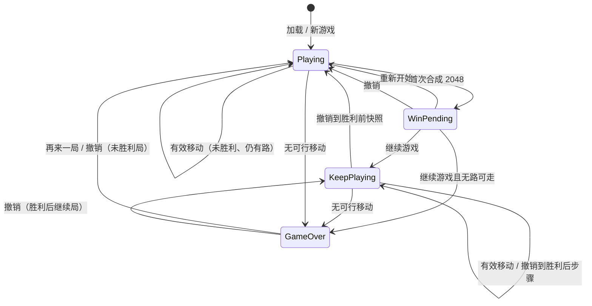
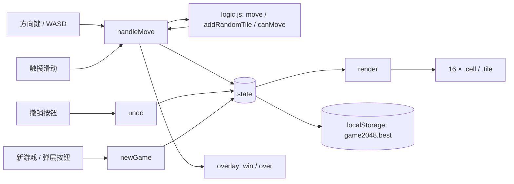

# 2048 小游戏 · 产品需求文档（PRD）

> **版本** 1.0 · **日期** 2026-10-20 · **状态** 已实现，待发布 · **维护者** Qsianuo
> **适用代码** `public/games/2048/`（基线 commit `1846fad`，已推送到 main；PRD 位于 `docs/PRDv1.0.md`，已纳入 Git 跟踪）
> **文档性质** 发布级 PRD：产品、规则、交互、技术、测试与发布标准一体；未实现能力统一标注【规划】。


---

## 文档控制

| 项目 | 内容 |
|------|------|
| 产品名称 | 2048 小游戏 |
| 文档版本 | 1.0（首版） |
| 产品版本 | v1.0.0（首发候选） |
| 文档状态 | 已实现，待发布 |
| 日期 | 2026-10-20 |
| 负责人 | Qsianuo（产品 / 设计 / 开发 / 测试，单人维护） |
| 评审 | 待补充 |
| 适用读者 | 产品、前端开发、测试、开源贡献者、招聘方 |
| 代码基线 | `1846fad`（main）；游戏目录 4 个文件、849 行、20,373 B |
| 访问路径 | `/games/2048/`（Express 静态托管）或直接打开 `index.html` |
| 许可 | 尚未添加 LICENSE，发布前需所有者确认 |

### 版本历史

| 版本 | 日期 | 类型 | 主要变更 |
|------|------|------|----------|
| v1.0 | 2026-10-20 | 首版 | 首个发布级 PRD：六项核心需求与 30 条可验收边界、17 条 FR、实现级算法与状态机、交互与无障碍审计、20 条 NFR、55 条测试用例、发布与风险体系、追溯矩阵 |

> 此前存在一份约 9.5 KB 的旧稿，未编号、未发布，已归档为 `docs/archive/2048-PRD-legacy-draft.md`，不作为本 PRD 的版本基线。

**本版对旧稿的事实修正**

| 项目 | 旧稿表述 | 核对结果 |
|------|-----------|----------|
| 深色模式 | 列为已完成能力 | CSS 中不存在 `prefers-color-scheme`，仅有浅色一套配色 |
| 自动化测试 | 里程碑写“单元测试完成” | 仓库内无测试文件、无 `test` 脚本；仅有开发期临时脚本，未入库、不可复现 |
| 无 Cookie | 对外表述为无 Cookie | 游戏代码不读写 Cookie，但 Express 的 `express-session` 会对静态资源下发 `connect.sid`（已实测） |
| 移动端可用率 100% | 作为 KPI | 仅有 375px 的实测记录；320/414px 未系统验证，现改为可判定的 NFR |

### 标注与证据约定

| 标记 | 含义 |
|------|------|
| 【已实现】 | 当前源码中存在，且已逐行核对 |
| 【部分实现】 | 主路径可用，但存在明确缺口 |
| 【未实现 / 规划】 | 仅为本 PRD 目标或建议，代码中不存在 |
| 【建议】 | 部署、运维或体验建议，不代表当前状态 |
| 【源码】/【实测】/【计算】/【待验】 | 结论的证据类型；【实测】为 2026-10-20 本机一次性执行结果，不构成持续回归证据 |

### 六项内容检查表

本 PRD 必须让六项内容各自有明确结论。下表是阅读索引，也是文档完整性门槛：

| # | 六项内容 | 对应章节 | 本版结论 |
|---|----------|----------|----------|
| 1 | 产品定位与目标 | 1–5 | 定位为“零依赖、打开即玩、规则可审计”的开源参考实现；目标与非目标、KPI 均已量化 |
| 2 | 功能需求与优先级 | 7 | 17 条 FR，P0 10 条 / P1 6 条 / P2 1 条，全部附 Given/When/Then 与源码索引 |
| 3 | 规则与算法 | 8 | 棋盘、合并、四方向、计分、生成、判负、撤销与状态机均有实现级定义与算例 |
| 4 | 交互、响应式与无障碍 | 9 | 375px 布局已实测，320–1440px 有计算与验收方法；无障碍为“有基础、未达 WCAG AA”，缺口已登记（DEF-01～DEF-08、DEF-11） |
| 5 | 技术架构、部署与隐私 | 10–11 | 零依赖、无构建；Express 托管存在 Cookie 口径冲突；GitHub Pages 方案与检查清单已给出 |
| 6 | 测试、发布与风险 | 12–13 | 55 条用例、12 条发布准入、12 条风险、10 个开放问题，全部可追踪 |

---

## 目录

- [执行摘要](#执行摘要)
- [1. 背景与问题](#1-背景与问题)
- [2. 产品定位、目标与设计原则](#2-产品定位目标与设计原则)
- [3. 成功指标](#3-成功指标)
- [4. 用户与场景](#4-用户与场景)
- [5. 范围与优先级](#5-范围与优先级)
- [6. 六项核心需求与关键边界](#6-六项核心需求与关键边界)
- [7. 用户故事与功能需求](#7-用户故事与功能需求)
- [8. 游戏规则、算法与数据模型](#8-游戏规则算法与数据模型)
- [9. 信息架构、交互与视觉规范](#9-信息架构交互与视觉规范)
- [10. 非功能需求](#10-非功能需求)
- [11. 技术架构与部署](#11-技术架构与部署)
- [12. 测试计划与验收](#12-测试计划与验收)
- [13. 发布计划、风险与开放问题](#13-发布计划风险与开放问题)
- [14. 路线图与 Backlog](#14-路线图与-backlog)
- [15. 术语表](#15-术语表)
- [附录 A 需求追溯矩阵](#附录-a-需求追溯矩阵)
- [附录 B 关键算例推演](#附录-b-关键算例推演)
- [附录 C 代码索引](#附录-c-代码索引)
- [附录 D 变更记录模板](#附录-d-变更记录模板)

---

## 执行摘要

**2048 小游戏**是 `web-dev-agency` 仓库中的一个独立静态页面，位于 `public/games/2048/`，通过 `express.static` 挂载到 `/games/2048/`，也可以拷贝到任意静态托管或直接双击打开。它用 4 个文件、约 20 KB、零运行时依赖、零构建步骤，实现了标准 2048 的完整对局闭环：4×4 棋盘、四方向合并、随机生成、计分、最高分、20 步撤销、胜利后继续、无路可走判定、键盘与触摸操作、响应式布局与减弱动效。

**产品判断**：核心玩法已经完成，且实现质量的关键指标（体积、零外链、逻辑与 DOM 解耦、可注入随机源）优于“再做一个 2048 页面”的常规水平。当前阻碍“可直接发布”的不是玩法，而是**发布物料与可验证性**：

1. 仓库根目录没有 LICENSE，README 未包含 2048 章节；
2. 核心逻辑测试只在开发期以临时脚本执行过，未入库、无 CI；
3. 无障碍存在可感知缺口：数字块对比度不足、弹层未实现真正模态、棋盘变化无读屏播报；
4. 通过 Express 访问时，静态资源会收到 `Set-Cookie: connect.sid`，与“无 Cookie”的对外表述冲突。

**发布建议**：代码与本文档同步提交到 GitHub，状态标记为“已实现，待发布”；在 README 中如实列出上述已知限制，并按 [13. 发布计划](#13-发布计划风险与开放问题) 的准入清单处理阻断项。**不建议**在未修复对比度与 Cookie 口径前宣称“无障碍达标”或“完全无 Cookie”。

**关键事实**

| 项目 | 数值 | 证据 |
|------|------|------|
| 游戏文件 | 4 个，20,373 B（HTML 2,141 / CSS 6,068 / logic 4,543 / game 7,621） | 【实测】`wc -c` |
| 运行时依赖 / 构建步骤 | 0 / 0 | 【源码】 |
| 同源请求 / 第三方请求 | 4 / 0（favicon 可能额外 404） | 【源码】【实测】 |
| 棋盘 / 目标 | 4×4 / 2048 | 【源码】`logic.js:15-16` |
| 新方块概率 | 2 = 90%，4 = 10% | 【源码】`logic.js:45` |
| 撤销上限 | 20 步 | 【源码】`game.js:115` |
| 最高分存储 | `localStorage['game2048.best']` | 【源码】`game.js:6` |
| 已实现自动化测试 | 0（仅开发期临时脚本） | 【实测】 |

---

## 1. 背景与问题

### 1.1 项目背景

`web-dev-agency` 是一个前后端一体的商业接单官网（Express + 原生前端）。2048 是其中的独立互动页面，由 `server.js:20` 的静态中间件挂载；它不依赖站点的账号、订单、数据库或 API，可以单独抽取、自托管或部署到 GitHub Pages。

游戏由 4 个文件组成：

| 文件 | 大小 | 职责 |
|------|-----:|------|
| `index.html` | 2,141 B | 页面结构、得分区、工具栏、棋盘与弹层容器 |
| `style.css` | 6,068 B | 布局、色阶、动画、响应式与减弱动效 |
| `logic.js` | 4,543 B | 与 DOM 解耦的棋盘、移动、合并、判负逻辑（UMD） |
| `game.js` | 7,621 B | 状态机、输入绑定、渲染、撤销、最高分与弹层 |

这个体量是刻意控制的结果：无框架、无打包器、无图片、无网络字体、无第三方脚本。需要注意：**仓库整体**仍有服务端依赖（Express、sql.js 等），但**游戏页面本身**不加载它们。

### 1.2 要解决的问题

| 编号 | 问题 | 典型表现 | 本项目的应对 |
|------|------|----------|--------------|
| P1 | 进入成本高 | 门户页广告、跳转、登录、加载等待 | 直达静态页；无账号、无引导弹窗 |
| P2 | 移动端体验差 | 滑动带动页面滚动、棋盘溢出、按钮难点 | `touch-action: none`、24px 阈值、500px 上限的响应式布局 |
| P3 | 隐私与离线焦虑 | 第三方统计、必须联网、数据去向不明 | 零外链、零第三方脚本；仅保存本机最高分 |
| P4 | 实现不可读、不可复用 | 核心逻辑与 DOM/框架耦合，依赖构建链 | `logic.js` 采用 UMD，可在 Node 直接 `require`；无构建 |
| P5 | 功能膨胀 | 排行榜、任务、推送、皮肤干扰核心玩法 | 只保留“开局—移动—胜负—重开—撤销”闭环 |

> **问题陈述**：对想在碎片时间立刻玩一局的用户，现有 2048 入口常被广告、跳转、登录和移动端适配打断；对想阅读或复用实现的开发者，很多版本又把核心逻辑埋在框架与构建链里。本项目用约 20 KB、零依赖的静态实现，保证“打开即玩、规则正确、手机可玩、数据留在本机”，同时把逻辑与 DOM 解耦，便于测试和二次开发。

### 1.3 与常见在线版本的差异

下表只做定性比较；“常见/取决于站点”描述该类站点的典型形态，不是对某一具体站点的断言。

| 维度 | 门户/聚合站 | 本项目 | 可核实性 |
|------|-------------|--------|----------|
| 开始路径 | 首页 → 搜索/分类 → 详情 → 加载，可能穿插广告 | 直达 `/games/2048/`，无中间页 | 本项目源码可核实 |
| 账号 | 常见“可选登录/一键登录” | 无账号体系 | 本项目源码可核实 |
| 广告/导流 | 常见横幅、插屏、下载引导 | 无广告、无导流 | 本项目源码可核实 |
| 离线 | 通常需要联网；缓存策略不透明 | 静态文件可本地直接打开；HTTP 下无 Service Worker，断网刷新不可保证 | 本项目源码可核实 |
| 源码可审计 | 不可得 | 4 个文件、约 20 KB，可逐行阅读 | 本项目源码可核实 |
| 可修改/自托管 | 不可 | 可 fork、可改规则、可静态部署 | 本项目源码可核实 |
| 数据去向 | 第三方广告/统计范围通常不透明 | 游戏代码只写 `localStorage`；托管层 Cookie 问题见 §5.4 | 源码与响应头可核实 |
| 功能广度 | 可能更多（排行、社交、活动） | 更少，只覆盖核心玩法 + 撤销 | 本项目源码可核实 |

### 1.4 开源与展示价值

1. **逻辑可独立运行**：`logic.js` 使用 UMD 包装，浏览器挂到 `window.Game2048`，Node 中可直接 `require`。
2. **可测试性**：`addRandomTile(board, rng)` 允许注入随机源；`move()` 返回新棋盘而非原地修改，便于确定性断言。
3. **代码规模可控**：`logic.js` 164 行、`game.js` 280 行，无生成代码、无打包产物。
4. **部署简单**：资源引用全部为相对路径，可挂在任意子路径或 GitHub Pages。
5. **展示点明确**：纯函数式棋盘运算、输入统一抽象、基础无障碍语义、性能预算与隐私边界，都是可被审阅的工程样例。

---

## 2. 产品定位、目标与设计原则

### 2.1 一句话定位

**一个约 20 KB、零依赖、打开即玩、规则可审计的 2048 参考实现——既是小游戏，也是可读、可测、可自托管的前端样例。**

| 维度 | 选择 |
|------|------|
| 产品类型 | 单人休闲益智小游戏 |
| 平台 | 现代桌面与移动浏览器 |
| 分发 | 静态托管，或作为本仓库子路径 `/games/2048/` |
| 账号 | 无 |
| 数据 | 仅本机最高分（`localStorage`，键 `game2048.best`） |
| 商业模式 | 无；开源 / 作品展示 |
| 竞争维度 | 进入成本、规则正确性、透明度、可维护性，而非功能数量 |

### 2.2 产品目标

| 编号 | 目标 | 成功判据 | 关联 |
|------|------|----------|------|
| G1 | 规则正确 | 固定用例集（四方向、单次合并、计分、无效移动、生成、判负）100% 通过 | §8、§12 |
| G2 | 零门槛开始 | 打开页面后无需登录、安装、设置或阅读长说明，即可用方向键/滑动开始第一局 | J1 |
| G3 | 输入等价 | 同一棋盘、同一方向，方向键、WASD 与滑动得到相同结果 | J2/J3 |
| G4 | 隐私与运行边界清晰 | 游戏页面 0 个外部请求、0 个第三方脚本；仅使用本机最高分存储 | NFR-15/16 |
| G5 | 完整对局闭环 | 新局、移动、撤销、胜利后继续、无路可走、再来一局均可完成 | J1–J6 |
| G6 | 可维护、可展示 | 核心逻辑可在 Node 直接运行；无构建；首屏资源 ≤30 KB | NFR-01/17 |
| G7 | 移动端可用 | 320/375/414px 无横向滚动；棋盘内滑动不滚动页面；按钮可点 | TC-44 |

### 2.3 非目标

| 编号 | 非目标 | 原因 |
|------|--------|------|
| NG1 | 账号、云存档、在线排行榜、多人对战 | 需要后端、隐私与运营成本，偏离轻量定位 |
| NG2 | 广告、内购、付费皮肤 | 开源 / 展示项目，不承担商业化目标 |
| NG3 | 原生 App、PWA 安装、推送 | 需要应用商店 / Service Worker / 权限体系 |
| NG4 | 多棋盘尺寸、主题切换、音效 | 增加状态与测试面；列为后续候选 |
| NG5 | AI 自动游玩、回放、分享图生成 | 非核心玩法，且会显著增加代码与依赖 |
| NG6 | 服务端权威状态、反作弊 | 单机休闲游戏无此需求 |
| NG7 | 默认埋点、第三方分析 SDK | 与隐私优先原则冲突；如启用必须默认关闭并显式说明 |
| NG8 | 功能数量竞争 | 不以“功能最多”为目标，避免维护成本失控 |

### 2.4 设计原则

| 编号 | 原则 | 含义 | 实现依据 |
|------|------|------|----------|
| DP1 | 零依赖、零构建 | 运行不需要包管理器、打包器或框架 | 游戏目录无 `package.json`；`index.html:57-58` 仅两个本地脚本 |
| DP2 | 打开即玩 | 不登录、不选难度、不看启动页 | `newGame()` 在脚本末尾立即执行（`game.js:279`） |
| DP3 | 规则正确优先于表现力 | 合并、计分、判负必须可验证；动画不影响状态 | 逻辑独立在 `logic.js`；每次移动返回新状态；无效移动直接返回 |
| DP4 | 输入等价 | 方向键、WASD、滑动、弹层 Enter 映射到同一套动作 | 统一 `handleMove`（`game.js:101-142`） |
| DP5 | 隐私与离线优先 | 不引入外部请求、第三方脚本与远程字体 | 系统字体栈；无图片、无外链；无埋点 |
| DP6 | 可访问性“有基础，但不宣称达标” | 语义按钮、键盘可操作、基础 ARIA、尊重减弱动效 | 缺口见 §9.9 |
| DP7 | 反馈克制 | 只对“出现、合并、得分”给短促反馈 | 120 / 160 / 180ms；无音效、无全屏特效 |
| DP8 | 可测试、可复用 | 核心逻辑不依赖浏览器；随机性可注入 | `addRandomTile(board, rng)`、纯函数 `move` |

### 2.5 关键设计取舍

| 取舍 | 选择 | 代价 | 证据 |
|------|------|------|------|
| 动画方式 | 每步重建棋盘，只做“出现/合并/得分”动画，无位移动画 | 视觉不如原版顺滑；实现简单、状态与 DOM 不易失配 | `render()` 全量重建（`game.js:85`） |
| 进度保存 | 只保存最高分，不保存当前棋局 | 刷新或关闭页面会丢失当前局 | 仅 `game2048.best` |
| 新游戏确认 | 点击即重置，无二次确认 | 误点会丢失当前局与撤销历史 | `game.js:275` |
| 技术栈 | 原生 DOM，不引入框架 | 手动渲染与事件管理；但体积小、无构建 | `game.js:52-91` |
| 度量 | 默认不埋点 | 无法自动计算真实用户 KPI | 无分析脚本 |
| 无障碍 | 提供基础语义，不追求完整读屏体验 | 对比度、焦点管理、播报存在缺口 | §9.9 |

---

## 3. 成功指标

### 3.1 度量现状

截至本稿，仓库中没有埋点脚本、没有分析 SDK，`server.js` 也没有访问日志分析。因此除文件体积、代码扫描和人工验收外，**当前没有真实用户数据**。下文的“目标值”均为发布目标，不是当前实测结果；“现阶段数据来源”说明只能如何人工判断。

### 3.2 北极星指标

| 项目 | 内容 |
|------|------|
| 指标名 | 周有效对局数（Weekly Valid Games，WVG） |
| 定义 | 同一页面会话内产生 **≥10 次有效移动**记为 1 局；同一会话只计 1 次；按自然周汇总 |
| 目标 | 发布后前 2 周为基线期，不设增长目标；第 3–8 周 ≥ 30 局/周（官网 + GitHub 演示页合计），再按实际流量调整 |
| 现阶段数据来源 | 无埋点，**无法自动度量**；只能人工试玩记录定性判断 |
| 埋点后数据来源 | `session_end` 事件中 `move_count >= 10` 的会话数，按匿名 `session_id` 去重 |

不选“页面浏览量”作为北极星：它无法区分误入与真正游玩，也容易被刷新和爬虫放大。

### 3.3 体验指标

| ID | 指标 | 定义 | 目标 / 判定 | 数据来源（现阶段 → 埋点后） |
|----|------|------|-------------|------------------------------|
| E1 | 首屏可交互 | 从导航到棋盘渲染出 2 个方块、可响应第一次输入 | 本地 ≤1.0 s；Lighthouse 移动模拟 ≤2.0 s | Lighthouse 手动；埋点后 RUM |
| E2 | 首局开始率 | 产生至少 1 次有效移动的页面会话 / 页面会话 | ≥80% | 无埋点，不可量化；埋点后 `page_view` + 首次 `move` |
| E3 | 单局时长 | 首次有效移动至结束或离开页面的中位时长 | 中位数 2–10 分钟；p90 ≤30 分钟 | 人工计时；埋点后 `session_end.duration_ms` |
| E4 | 撤销使用率（诊断） | 使用过撤销的会话 / 有有效移动的会话 | 5%–20% 视为健康区间，仅诊断 | 埋点后 `undo` |
| E5 | 2048 达成率（诊断） | 出现胜利弹层的会话 / 有效对局 | 不设提升目标，建立基线 | 埋点后 `win` |

### 3.4 质量指标

| ID | 指标 | 目标 / 判定 | 当前证据 |
|----|------|-------------|----------|
| Q1 | 规则用例通过率 | 100% | 开发期临时脚本通过；测试未入库，不作为持续证据 |
| Q2 | 未捕获错误 | 0 / 会话 | 待系统化验证 |
| Q3 | 首屏体积 | ≤30 KB；当前 20,373 B | 【实测】达标 |
| Q4 | 外部/第三方请求 | 0 / 0 | 【源码】仅 4 个同源资源；favicon 可能 404 |
| Q5 | 移动端布局 | 320/375/414px 无横向滚动 | 375px 已实测；320/414px 待系统验证 |
| Q6 | 存储降级 | 禁用存储时游戏可完整游玩且无未捕获错误 | 代码有 try/catch；待系统化测试 |
| Q7 | 键盘可达 | 仅键盘可完成移动、撤销、新游戏、弹层选择 | 部分可达；弹层 Enter 存在焦点不一致缺陷 |
| Q8 | 文本对比度 | WCAG AA：正文 ≥4.5:1，大文本 ≥3:1 | **当前多处不达标**（见 §9.9.3） |

### 3.5 埋点启用后的度量方案【规划】

当前没有任何埋点。若未来部署方需要真实数据，建议采用以下方案，并**默认关闭、在 README 中显式说明**：

| 事件 | 触发时机 | 关键属性 | 用途 |
|------|----------|----------|------|
| `page_view` | 页面加载完成 | 视口档位、来源类型（不存完整 URL）、是否新会话 | 计算分母 |
| `game_start` | 初始开局 / 点击新游戏 / 弹层重开 | `source`（initial/button/overlay） | 开局来源 |
| `move` | 每次有效移动 | 方向、得分增量、最大方块、步序（会话末聚合） | 规则与难度分析 |
| `undo` | 点击撤销 | 当前步序 | 撤销率 |
| `win` | 首次合成 2048 | 步数、得分、耗时 | 达成率 |
| `game_over` | 无可行移动 | 步数、得分、最大方块、耗时 | 结束分布 |
| `session_end` | `pagehide` | 步数、时长、最大方块、结束原因 | 北极星、时长 |

约束：不采集棋盘内容、按键内容、完整 URL、IP；不使用 Cookie；匿名 `session_id` 存 `sessionStorage`；`sendBeacon` 批量上报；端点自托管；原始事件保留 30 天；开源仓库默认不启用。启用远程采集会破坏“零网络请求”承诺，必须作为独立需求评审。

---

## 4. 用户与场景

### 4.1 用户分层

| 用户群 | 典型场景 | 核心需求 | 成功信号 | 优先级 |
|--------|----------|----------|----------|--------|
| 碎片时间休闲玩家 | 工作间隙、排队、睡前 | 立刻开局、规则直观、随时退出 | 首局开始并完成多次移动 | 主要 |
| 移动端单手用户 | 通勤、站立、单手拿手机 | 滑动操作、不误触滚动、布局不溢出 | 移动端会话可完成对局 | 主要 |
| 开发者 / 招聘方 / 贡献者 | 阅读源码、评估前端能力、提 issue | 结构清晰、逻辑可独立运行、无构建 | 能读懂并运行核心逻辑 | 次要但关键 |
| 站点访客 / 潜在客户 | 浏览商业官网时看到互动内容 | 不打断浏览、加载快、不要求登录 | 愿意玩一局并记住站点 | 次要 |
| 隐私敏感 / 低配置用户 | 老旧设备、隐私模式、弱网 | 不联网、不追踪、低内存占用 | 页面可打开且无报错 | 次要 |

### 4.2 画像（设计假设，未做用户调研）

> 以下画像用于约束设计取舍，**不是用户访谈或调研结果**。发布后应通过 GitHub issue、站点反馈和埋点数据校正。

| 画像 | 假设特征 | 目标 | 痛点 | 对应设计 |
|------|----------|------|------|----------|
| P1 通勤中的轻度玩家 | 25–35 岁，手机为主，单次 3–10 分钟，讨厌广告与注册 | 单手玩几局，破自己的最高分 | 广告打断、滑动误触、页面滚动 | 触摸滑动、`touch-action: none`、最高分本地保存、无登录 |
| P2 前端招聘方 / 开发者 | 桌面为主，停留 2–5 分钟，会打开 DevTools | 快速判断代码质量与可维护性 | 框架黑盒、构建复杂、逻辑与 DOM 耦合 | 4 文件、UMD、纯逻辑、可在 Node 运行、无构建 |

### 4.3 JTBD

| 类型 | Job story | 对应能力 |
|------|-----------|----------|
| 功能 | 当我有一小段空闲时间，我想立刻开始一局不用注册的游戏，以便放松而不被中断 | 打开即玩、无登录、无启动页 |
| 功能 | 当我在手机上玩时，我想滑动操作且页面不跟着滚动，以便单手完成对局 | 触摸手势、24px 阈值、`touch-action: none` |
| 功能 | 当我误操作时，我想撤回一步，以便不毁掉整局 | 20 步撤销 |
| 功能 | 当我打出高分时，我想下次回来还能看到最高分，以便继续挑战 | `localStorage` 最高分 |
| 情感 | 当我在碎片时间玩小游戏时，我不想被广告、推送或账号请求打扰，以便感到可控 | 零广告、零第三方脚本、零账号 |
| 职业 | 当我想评估或复用一个前端实现时，我想看到短小、可运行、可测试的源码，以便做出判断 | 逻辑解耦、UMD、无构建 |

### 4.4 核心用户旅程

| 旅程 | 关键步骤 | 可验收结果 |
|------|----------|------------|
| J1 首次访问 | 打开页面 → 看到棋盘与 2 个初始方块 → 第一次按键/滑动 | 恰好 2 个方块、得分 0、最高分为历史值、撤销禁用、控制台无错误 |
| J2 桌面游玩 | 按方向键或 WASD → 连续移动 | 方向一致、不区分大小写、页面不滚动、分数实时更新 |
| J3 移动游玩 | 单指在棋盘滑动 → 松开 | ≥24px 触发移动；<24px 视为点击；页面不滚动；375px 无横向溢出 |
| J4 误操作撤销 | 完成有效移动 → 点击撤销 | 恢复棋盘与分数；最多 20 步；无历史时按钮禁用；可关闭弹层 |
| J5 达成 2048 | 合成 2048 → 胜利弹层 → 继续 / 重开 | 弹层含两个按钮、焦点在主按钮；继续保留局面且不再重复弹窗 |
| J6 无路可走 | 最后一步填满棋盘 → 结束弹层 → 再来一局 | 结束层仅主按钮；重开后 2 个方块、得分 0、撤销禁用 |

旅程中的主要摩擦：刷新丢局、新游戏无二次确认、无位移动画、读屏体验不完整、对比度不足、窄屏隐藏操作提示、无成绩分享。对应机会均列入 [14. 路线图](#14-路线图与-backlog)。

---

## 5. 范围与优先级

### 5.1 本期范围【已实现】

| ID | 能力 | 说明 | 源码依据 |
|----|------|------|----------|
| S1 | 4×4 棋盘、目标 2048 | `SIZE=4`、`TARGET=2048` | `logic.js:15-16` |
| S2 | 初始 2 个方块，2/4 概率 90%/10% | 新局调用两次随机生成 | `game.js:161-163`、`logic.js:45` |
| S3 | 四方向移动与合并 | 相邻同值合并，每块每步最多一次 | `logic.js:51-130` |
| S4 | 计分 | 每次合并得分等于合并后数值 | `logic.js:62` |
| S5 | 最高分 | `localStorage` 键 `game2048.best`；只增不减；不可用时降级 | `game.js:6,33-48,129-132` |
| S6 | 撤销 | 最多 20 个快照；恢复棋盘、分数与胜负状态 | `game.js:108-115,144-158` |
| S7 | 新游戏 | 重置棋盘、分数、胜负与撤销历史 | `game.js:160-174` |
| S8 | 胜利与继续 | 合成 2048 弹层；可继续，不重复弹出 | `game.js:123-126,178-187,203-212` |
| S9 | 游戏结束与重开 | 无可行移动时弹层；可再来一局 | `game.js:127,189-196` |
| S10 | 键盘输入 | 方向键、WASD（不区分大小写）、弹层 Enter | `game.js:216-242` |
| S11 | 触摸输入 | 单指滑动，阈值 24px；棋盘内不滚动页面 | `game.js:246-272`、`style.css:180` |
| S12 | 响应式布局 | 最大宽度 500px；≤420px 隐藏操作提示 | `style.css:36,319-331` |
| S13 | 动效与减弱动效 | 出现 120ms、合并 160ms、得分 180ms；尊重 `prefers-reduced-motion` | `style.css:94,208,212,338-345` |
| S14 | 零依赖与隐私基线 | 0 运行时依赖、0 外部请求、0 第三方脚本、无埋点 | `index.html:57-58`；静态扫描 |

### 5.2 不在本期范围

| 能力 | 状态 | 原因 / 计划 |
|------|------|-------------|
| 当前棋局持久化与恢复 | 【未实现】 | 刷新即丢局；v1.1 候选 |
| 新游戏二次确认 | 【未实现】 | 存在误点丢局风险；v1.1 候选 |
| 完整无障碍（ARIA 行结构、棋盘播报、焦点陷阱 / 恢复、Escape 关闭） | 【未实现】 | 当前只有基础语义 |
| 文本对比度达标 | 【未实现】 | 多组颜色低于 WCAG AA |
| 自动化测试入库与 CI | 【未实现】 | 仅做过临时脚本验证 |
| LICENSE、README 游戏章节、GitHub Pages 配置 | 【未实现】 | 开源发布前置物料 |
| 埋点与真实用户 KPI | 【未实现】 | 默认不启用 |
| PWA / Service Worker / 安装 | 【未实现】 | 超出静态页范围 |
| 主题切换、音效、多棋盘尺寸 | 【未实现】 | 后续候选 |
| 本地排行榜、成绩分享图 | 【未实现】 | 后续候选 |
| AI 自动游玩、回放、多人、账号、云存档 | 【未实现】 | 与轻量定位冲突，明确不做 |
| 国际化 | 【未实现】 | 当前仅简体中文界面 |

### 5.3 MoSCoW 优先级

| 级别 | 条目 | 状态 | 验收/说明 |
|------|------|------|-----------|
| Must | 4×4 规则、四方向合并、计分、随机生成 | 【已实现】 | 固定夹具 100% 通过 |
| Must | 键盘/WASD/触摸/Enter 输入 | 【已实现】 | 同一棋盘同方向结果一致 |
| Must | 最高分、撤销、新游戏、胜利/结束弹层 | 【已实现】 | J4–J6 的 Given/When/Then |
| Must | 响应式与减弱动效 | 【已实现】 | 320/375 无横向滚动；减少动效下动画近似关闭 |
| Must（发布前） | LICENSE | 【未实现】 | 需所有者选择（建议 MIT，需确认） |
| Must（发布前） | README 增加游戏章节与运行方式 | 【未实现】 | 当前 README 只描述商业官网 |
| Must（发布前） | 测试入库 + 可重复执行的测试命令 | 【未实现】 | 建议 Node 内置 test runner |
| Should | 对比度修复与 axe/CI 检查 | 【未实现】 | 达到 Q8 目标 |
| Should | ARIA 行结构、弹层焦点陷阱与恢复 | 【未实现】 | 键盘/读屏可完成核心流程 |
| Should | 新游戏二次确认或可撤销重开 | 【未实现】 | 降低误点丢局 |
| Could | 主题、音效、多尺寸、本地排行榜、分享图 | 【未实现】 | 需评估体积与测试成本 |
| Won't | 账号、云存档、在线排行榜、多人、广告、内购、原生 App、默认埋点 | 【不做】 | 与定位冲突 |

### 5.4 假设与依赖

| ID | 假设/依赖 | 影响 | 现状 |
|----|-----------|------|------|
| A1 | 静态托管或 `express.static` 子路径部署 | 资源使用相对路径，可挂 `/games/2048/` 或 GitHub Pages | 已满足 |
| A2 | 现代浏览器：CSS Grid、`aspect-ratio`、passive 事件、`localStorage` | 不引入 polyfill；旧浏览器可能布局或交互异常 | 未声明最低版本 |
| A3 | 单人维护，无持续运营预算 | 不引入后端、账号、推送、在线排行 | 与 NG1 一致 |
| A4 | 开源许可证由仓库所有者确认 | 无许可证时他人无法合法复用 | 根目录无 LICENSE |
| D1 | 游戏页面由本仓库 Express 托管 | `express-session` 的 `saveUninitialized: true` 会对静态资源下发 `connect.sid`，与“无 Cookie”表述冲突（已实测） | **需发布前决策** |
| D2 | 通过 HTTP 首次加载后的离线能力 | 无 Service Worker；断网刷新不保证可用 | 无 SW |
| D3 | 浏览器自动请求 `/favicon.ico` | 可能产生同源 404，不属于外部请求 | 未提供 favicon |
| D4 | `localStorage` 可能被隐私模式/策略禁用 | 最高分只在当前页面内存有效，刷新后丢失 | try/catch 降级 |

### 5.5 开源发布门槛

截至本稿，游戏目录与 PRD 均已纳入 Git 跟踪（游戏 `1846fad`，PRD `docs/PRDv1.0.md`）；根目录没有 LICENSE，README 未包含 2048 章节，测试文件不在仓库中。发布前逐项确认：

- [x] 核心玩法、输入、计分、撤销、胜负流程已实现
- [ ] 选择并添加 LICENSE（需所有者确认；若参考原版 2048，应核对许可证兼容性）
- [ ] README 增加“2048 小游戏”章节：访问路径、运行方式、功能、浏览器要求、隐私说明
- [ ] 将核心规则测试纳入仓库，并提供 `npm test` 或等价的单命令执行方式
- [ ] 处理 D1 的 Cookie 冲突：调整 `express-session` 配置/中间件顺序，或在文档中明确“站点会写入会话 Cookie”
- [ ] 修复对比度，或在 README/Issue 中列为已知限制
- [ ] 补充 320/375/414px 的可复现验收记录（截图或自动化测试）
- [ ] 确认开源范围：仅游戏目录，还是包含整个官网仓库；若包含整个仓库，需先处理硬编码 `session.secret` 与默认管理员口令
- [x] 游戏目录已纳入 Git 跟踪并推送到 main（`1846fad`）
- [x] PRD `docs/PRDv1.0.md` 纳入 Git 跟踪并提交

---

## 6. 六项核心需求与关键边界

本章是发布验收的主框架。全部功能被归并为 **6 项核心需求（R1–R6）**；每项需求下列出可执行边界（B-xx），每条边界都映射到功能需求（FR）与测试用例（TC）。**判定规则：P0 边界必须全部通过；任一 P0 边界未映射到可执行用例，即视为验收未完成。**

### 6.1 六项核心需求总览

| ID | 核心需求 | 包含 FR | 用户价值 | P0 边界 | 验收依据 |
|----|----------|---------|----------|---------|----------|
| R1 | 棋盘与合并规则 | FR-01、FR-02、FR-03 | 玩法正确、结果可预期 | B-01～B-07 | TC-01～TC-09 |
| R2 | 随机生成与计分 | FR-04、FR-05 | 每一步都有新变化，得分可信 | B-08～B-11 | TC-10～TC-14 |
| R3 | 输入与操作 | FR-10、FR-11 | 桌面与手机都能顺畅操作 | B-12～B-16 | TC-34～TC-42 |
| R4 | 胜负与对局闭环 | FR-07、FR-08、FR-12、FR-13 | 赢有反馈、输有出口、随时重开 | B-17～B-22 | TC-20～TC-26、TC-32～TC-33、TC-55 |
| R5 | 最高分与撤销 | FR-06、FR-09 | 纪录保留、误操作可回退 | B-23～B-25 | TC-15～TC-19、TC-27～TC-31 |
| R6 | 体验与运行边界 | FR-14、FR-15、FR-16、FR-17 | 手机可玩、反馈清晰、隐私可控 | B-26～B-30 | TC-43～TC-46、TC-49～TC-54 |

### 6.2 R1 棋盘与合并规则

**目标**：在 4×4 棋盘上正确执行标准 2048 合并，任何输入都能得到确定、可复现的结果。

**核心规则**

- 棋盘为行优先的 4×4 数字矩阵，`0` 表示空格；目标值为 2048。
- 移动时先按方向读取整行/列，去掉 0，再从左向右扫描；相邻同值合并为两倍并跳过被合并项，保证每块每步最多合并一次；尾部补 0。
- 任一格发生位移或合并即为有效移动；否则不生成方块、不计分、不写撤销历史。
- 合并顺序由“靠近移动方向的一侧优先”决定；`right` 是 `left` 的行镜像，`down` 是 `up` 的列镜像。

**关键边界（可验收）**

| 边界 ID | 场景 / 前置 | 操作 | 预期结果 | FR | 用例 |
|---------|-------------|------|----------|----|------|
| B-01 | 全新加载，无存档 | 打开页面 | 16 格中恰好 2 个方块，值为 2 或 4，且位于不同格子；得分 0；撤销禁用 | FR-01 | TC-01、TC-02 |
| B-02 | 首行 `2 2 4 4`，其余为空 | 左移 | 首行 `4 8 0 0`，得分 +12 | FR-03、FR-05 | TC-03 |
| B-03 | 首行 `2 2 2 2` | 左移 | 首行 `4 4 0 0`，得分 +8；**不得**得到单个 8 | FR-03 | TC-07 |
| B-04 | 首行 `4 4 8 0` | 左移 | 首行 `8 8 0 0`，得分 +8；新 8 不再与既有 8 合并 | FR-03 | TC-08 |
| B-05 | 首行 `2 4 2 4` | 左移 | `moved=false`；棋盘、得分、撤销历史均不变；不生成新方块 | FR-03 | TC-09 |
| B-06 | 16 格全满且存在横向或纵向同值对 | 向可合并方向移动 | 必须允许合并并生成新方块，不得在移动前判负；生成后按 `canMove` 重新判定是否结束 | FR-03、FR-08 | TC-26 |
| B-07 | 已合成 4096 / 8192 | 继续游玩 | 使用 `.tile-super` 样式；游戏继续；不再弹出胜利层 | FR-02、FR-07 | TC-22、TC-47 |

### 6.3 R2 随机生成与计分

**目标**：每次有效移动只生成一个新方块；得分严格等于本步所有合并值之和。

**核心规则**

- 每次有效移动、棋盘更新后，在所有空格中均匀选一格，生成 2（90%）或 4（10%）。
- 新方块生成发生在胜负判定之前；无效移动不生成。
- 每对 `v + v` 合并为 `2v`，得分增加 `2v`；一次移动中多组合并的得分累加。
- 生成的新方块不计分；最高分只增不减。

**关键边界（可验收）**

| 边界 ID | 场景 / 前置 | 操作 | 预期结果 | FR | 用例 |
|---------|-------------|------|----------|----|------|
| B-08 | 有效移动后至少 1 个空格 | 完成移动 | 方块总数 = 移动前 − 合并次数 + 1；新块位于原空格，值为 2 或 4 | FR-04 | TC-10、TC-13 |
| B-09 | 棋盘已满、无空格 | 直接调用 `addRandomTile` | 返回 `null`，棋盘不变，不抛异常 | FR-04 | TC-12 |
| B-10 | 一次移动发生两组合并 | 结算 | 得分为两组合并值之和，不是只计一次 | FR-05 | TC-03、TC-14 |
| B-11 | 无效移动（B-05） | 按键 | 不生成新方块、不加分、不写历史 | FR-04、FR-05 | TC-09 |

### 6.4 R3 输入与操作

**目标**：键盘与触摸映射到同一套动作，且不干扰页面滚动。

**核心规则**

- 方向键与 WASD（不区分大小写）等价；带 Alt/Ctrl/Meta 的组合键被忽略。Shift 目前未被排除（见 Q-01）。
- 触摸只记录单指起点；`max(|dx|,|dy|) < 24px` 视为点击，否则按主轴方向移动。
- 棋盘使用 `touch-action: none`；方向键命中时 `preventDefault()`，页面不滚动。
- 弹层可见时方向输入被锁定；Enter 等价于点击主按钮。

**关键边界（可验收）**

| 边界 ID | 场景 / 前置 | 操作 | 预期结果 | FR | 用例 |
|---------|-------------|------|----------|----|------|
| B-12 | 页面可滚动 | 按方向键 / WASD | 棋盘移动且 `window.scrollY` 不变；大小写等价 | FR-10 | TC-34、TC-35 |
| B-13 | 任意局面 | 按 Ctrl/Alt/Meta + 方向键 | 不移动、不生成、不计分 | FR-10 | TC-36 |
| B-14 | 触屏设备 | 滑动 23px / 24px | 23px 不移动；24px 触发一次移动 | FR-11 | TC-38 |
| B-15 | 触屏设备 | 双指同时按下并抬起 | 不产生移动、页面不缩放；顺序多指行为记录为已知缺陷 DEF-11 | FR-11 | TC-40、TC-41 |
| B-16 | 胜利 / 结束弹层显示 | 按方向键；按 Enter | 方向键不改变棋盘；Enter 触发主按钮 | FR-10、FR-13 | TC-37 |

### 6.5 R4 胜负与对局闭环

**目标**：胜利、继续、结束、撤销与新游戏形成完整闭环，任何状态下都有明确出口。

**核心规则**

- 任一有效移动后全盘最大值 ≥2048 且本局尚未提示，弹出胜利层；本局不再重复弹出。
- 胜利层：主按钮“继续游戏”保留局面；次按钮“重新开始”开新局。
- 无有效移动时弹出结束层，仅“再来一局”；结束层不显示次按钮。
- 胜利与无路可走同时发生时，先显示胜利层；选择继续后立即显示结束层。
- 弹层覆盖棋盘但不覆盖工具栏，因此鼠标用户可点“撤销”退出弹层；键盘用户只能通过 Enter 继续（已知交互不一致，DEF-02）。

**关键边界（可验收）**

| 边界 ID | 场景 / 前置 | 操作 | 预期结果 | FR | 用例 |
|---------|-------------|------|----------|----|------|
| B-17 | 两个 1024 相邻 | 向两者方向移动 | 生成 2048；胜利层出现；主按钮获得焦点；得分 +2048 | FR-07、FR-13 | TC-20 |
| B-18 | 胜利层显示 | 点击“继续游戏” | 棋盘与得分不变；弹层关闭；可继续移动；不再重复弹窗 | FR-07 | TC-21、TC-22 |
| B-19 | 同一步达成 2048 且生成后无可行移动 | 点击“继续游戏” | 胜利层关闭后立即显示结束层，仅“再来一局” | FR-07、FR-08 | TC-55 |
| B-20 | 结束层显示 | 点击“再来一局”或按 Enter | 新局 2 个方块、得分 0、撤销禁用、弹层关闭、最高分保留 | FR-08、FR-12 | TC-24、TC-25 |
| B-21 | 胜利层或结束层显示、历史非空 | 点击“撤销” | 弹层关闭；恢复该步前棋盘、分数与标志；可继续游玩 | FR-09、FR-13 | TC-30、TC-31 |
| B-22 | 任意对局 | 点击“新游戏” | 立即重置棋盘/分数/历史，无二次确认；最高分保留 | FR-12 | TC-32、TC-33 |

### 6.6 R5 最高分与撤销

**目标**：最高分跨会话保留且只增不减；撤销能精确回退最近 20 步。

**核心规则**

- 最高分键固定为 `game2048.best`；仅当本局分数超过历史值时写入；读取非法值按 0 处理。
- 读、写均捕获异常；存储不可用时降级为内存值，刷新后丢失，但不影响游玩。
- 每次有效移动前保存 `{board, score, won, keepPlaying, over}` 快照；最多 20 条，超出丢弃最旧。
- 撤销恢复快照、清空动画标记、关闭弹层；不恢复最高分，不恢复随机数状态，不支持重做。

**关键边界（可验收）**

| 边界 ID | 场景 / 前置 | 操作 | 预期结果 | FR | 用例 |
|---------|-------------|------|----------|----|------|
| B-23 | 最高分 100，本局达到 120 | 刷新页面 | 最高分显示 120 并持久化；新游戏或撤销不降低最高分 | FR-06 | TC-15、TC-16 |
| B-24 | `localStorage` 读写抛异常 | 完成一局并刷新 | 无未捕获异常；最高分当前会话可用；刷新后归 0 | FR-06 | TC-17、TC-18 |
| B-25 | 连续 21 次有效移动 | 连续撤销 | 最多回退 20 步；随后按钮禁用；第 21 次点击无效果 | FR-09 | TC-28、TC-29、TC-30 |

### 6.7 R6 体验与运行边界

**目标**：在主流桌面与移动视口下可玩、可读、可关闭动效，并保持零外部请求与最小数据足迹。

**核心规则**

- 页面最大宽度 500px；≤420px 隐藏操作提示并压缩得分框；320–1440px 无横向滚动。
- 新方块出现 120ms、合并 160ms、得分跳动 180ms；`prefers-reduced-motion` 下动画近似关闭。
- 页面仅加载 4 个同源资源；无 fetch/XHR/WebSocket/第三方脚本/埋点；仅写最高分。
- 基础语义：`role=grid`、`gridcell`、`dialog`、`aria-live`、原生按钮、焦点轮廓。
- 已知缺口：对比度不达标、无焦点陷阱/Esc、无棋盘播报、grid 缺行结构、窄屏隐藏操作提示（见 §9.9）。

**关键边界（可验收）**

| 边界 ID | 场景 / 前置 | 操作 | 预期结果 | FR | 用例 |
|---------|-------------|------|----------|----|------|
| B-26 | 视口 320 / 375 / 390 / 768 / 1440 | 加载页面 | `scrollWidth === clientWidth`；棋盘宽高相等；420px 时提示隐藏、421px 显示 | FR-14 | TC-43、TC-44、TC-45 |
| B-27 | 系统开启“减少动态效果” | 执行移动与撤销 | 计算样式动画/过渡 ≤1ms；功能与计分不受影响 | FR-15 | TC-46 |
| B-28 | 打开页面并游玩 10 步 | 查看 Network 与 Application | 仅 4 个同源请求，0 第三方；仅 `game2048.best`；Express 下 Cookie 例外见 DEF-12 | FR-16 | TC-49、TC-50 |
| B-29 | 仅用键盘 | 完成移动、撤销、新游戏、弹层选择 | 全部可触发；焦点轮廓可见；已知 Enter 焦点问题记录为 DEF-02 | FR-17 | TC-51、TC-52 |
| B-30 | 存储写入抛 `QuotaExceededError` | 刷新最高分 | 页面不报错；最高分当前会话更新；刷新后归 0 | FR-06 | TC-18 |

### 6.8 边界验收规则

1. **可执行**：每条边界必须有明确前置、操作与预期，不接受“体验流畅”这类不可判定表述。
2. **可映射**：每条 P0 边界必须映射至少 1 个 TC；无对应用例的边界视为【待验】，不得计入通过。
3. **可复现**：逻辑类边界用 Node `require('./logic.js')` 构造固定棋盘断言；界面类边界用浏览器 / jsdom / 真机按 §12 执行。
4. **判定**：P0 边界全部 PASS、P1 用例通过率 ≥95%、无未豁免的 S1，且所有 S2 均有修复计划或书面豁免，方可发布；豁免必须记录责任人与到期日。
5. **边界不扩权**：任何“通过”仅代表当前基线；变更合并、生成、判负、撤销逻辑必须重跑 R1/R2/R4/R5 的全部 P0 边界。

---

## 7. 用户故事与功能需求

### 7.1 用户故事

| ID | 用户故事 | 主要 FR | 优先级 | 验收摘要 |
|----|----------|---------|--------|----------|
| US-01 | 作为首次访问者，我想打开页面就立刻开始，以便不注册、不设置 | FR-01、FR-02 | P0 | 无引导层；恰好 2 个初始方块；撤销禁用 |
| US-02 | 作为玩家，我想用方向键合并相同数字，以便推进对局 | FR-03 | P0 | 四方向正确；每块每步只合并一次 |
| US-03 | 作为玩家，我想看到分数随合并增长，以便知道进展 | FR-05 | P0 | 得分等于合并值之和 |
| US-04 | 作为玩家，我想保留历史最高分，以便下次继续挑战 | FR-06 | P0 | 刷新后保留；新游戏/撤销不降低 |
| US-05 | 作为玩家，我想撤销误操作，以便不因一次失误毁掉整局 | FR-09 | P1 | 最多 20 步；恢复分数与胜负状态 |
| US-06 | 作为玩家，我想在合成 2048 后选择继续，以便挑战更高分 | FR-07、FR-13 | P0 | 继续保留局面；不重复弹窗 |
| US-07 | 作为玩家，我想在无路可走时重开，以便快速进入下一局 | FR-08、FR-12 | P0 | 结束层仅主按钮；重开后状态清零 |
| US-08 | 作为桌面用户，我想用方向键/WASD 操作且页面不滚动 | FR-10 | P0 | 大小写等价；修饰键忽略；不滚动 |
| US-09 | 作为手机用户，我想滑动操作且不误触页面滚动 | FR-11 | P0 | 24px 阈值；`touch-action: none` |
| US-10 | 作为隐私敏感用户，我想页面不联网、不追踪，以便放心游玩 | FR-16 | P1 | 0 第三方请求；仅本机最高分 |
| US-11 | 作为开发者，我想直接运行核心逻辑与测试用例，以便评估或复用 | FR-03、FR-04 | P1 | `require('./logic.js')` 可用；随机源可注入 |

### 7.2 功能需求总览

| FR | 名称 | 优先级 | 六项归属 | 核心验收 | 实现 |
|----|------|--------|----------|----------|------|
| FR-01 | 初始化棋盘与新局 | P0 | R1 | 2 个不同格子的 2/4；分数 0；历史空 | `game.js:160-174` |
| FR-02 | 棋盘渲染 | P0 | R1 | 16 格；值/样式/动画类正确；最高分同步 | `game.js:52-91` |
| FR-03 | 四方向移动与合并 | P0 | R1 | 纯函数；单次合并；无效移动不变 | `logic.js:51-130` |
| FR-04 | 随机生成新方块 | P0 | R2 | 90%/10%；仅空格；满盘返回 null | `logic.js:34-48` |
| FR-05 | 计分 | P0 | R2 | 合并值累加；生成不计分 | `logic.js:62,119`、`game.js:118` |
| FR-06 | 最高分持久化 | P0 | R5 | 只增不减；跨刷新；异常降级 | `game.js:6,33-48,129-132` |
| FR-07 | 胜利与继续 | P0 | R4 | 首次 2048 弹层；继续不重复 | `game.js:123-126,178-187,203-210` |
| FR-08 | 游戏结束判定 | P0 | R4 | 满盘且无相邻同值；结束层 | `logic.js:132-141`、`game.js:127,189-196` |
| FR-09 | 撤销 | P1 | R5 | 20 步；恢复五字段；关闭弹层 | `game.js:108-115,144-158` |
| FR-10 | 键盘输入 | P0 | R3 | 方向键/WASD；Enter；忽略修饰键 | `game.js:216-242` |
| FR-11 | 触摸输入 | P0 | R3 | 单指；24px；主轴判定 | `game.js:244-272` |
| FR-12 | 新游戏 | P0 | R4 | 重置棋盘/分数/历史；保留最高分 | `game.js:160-174,275` |
| FR-13 | 弹层交互 | P1 | R4 | 文案/按钮/显隐/焦点/优先级 | `game.js:178-212` |
| FR-14 | 响应式布局 | P1 | R6 | 320–1440px 无横向滚动；棋盘为方 | `style.css:20-37,171-182,319-336` |
| FR-15 | 动效与减弱动效 | P2 | R6 | 120/160/180ms；减少动效下近似关闭 | `style.css:92-100,207-240,338-345` |
| FR-16 | 隐私与零外链 | P1 | R6 | 0 外部请求；仅最高分存储；无埋点 | `index.html:1-60`、`game.js:33-48` |
| FR-17 | 基础无障碍与键盘可达 | P1 | R6 | 语义/焦点/播报基础；缺口登记 | `index.html:11-54`、`game.js:60-79,186,195` |

**优先级口径**：P0 = 缺失或错误则核心玩法不成立，发布阻断；P1 = 缺失会显著降低可用性/可信度，本期应完成；P2 = 体验增强，可在后续版本完成。FR-15 已实现，但按“缺失是否阻断发布”评为 P2；无障碍整改时仍应与 FR-17 一并验收。

### 7.3 功能需求详述

#### FR-01 初始化棋盘与新局 · P0

**规则**：创建 4×4 全 0 棋盘，连续调用两次随机生成；分数归 0，`won/keepPlaying/over` 归 false，撤销历史清空，弹层隐藏。脚本加载后立即执行一次，因此不存在“空白等待开始”的状态。

**验收**
- Given 无任何存档，When 页面加载完成，Then 棋盘恰好有 2 个非零格，值为 2 或 4，格子不重复，得分为 0，撤销按钮禁用。
- Given 对局进行中，When 点击“新游戏”，Then 棋盘重置为 2 个方块，分数 0，撤销禁用，最高分不变。

**实现**：`game.js:160-174,279`；边界 B-01、B-22；用例 TC-01、TC-02、TC-32。

#### FR-02 棋盘渲染 · P0

**规则**：按行优先渲染 16 个 `.cell`（`role=gridcell`）；非零格内创建 `.tile`，类名为 `tile-<value>`，大于 2048 使用 `tile-super`；4 位数加 `.long`，5 位及以上加 `.xlong`；本次生成块加 `.new`，本次合并块加 `.merged`；同步得分、最高分与撤销禁用状态。每次渲染全量重建，避免 DOM 与状态失配。

**验收**
- Given 棋盘含 2、4、8、1024、4096、16384，When 渲染，Then 分别命中 `tile-2/4/8/1024/tile-super`；1024 与 4096 带 `long`；16384 带 `long xlong`。
- Given 一次有效移动产生新块与合并块，When 渲染完成，Then 新块有 `new`，合并块有 `merged`，且仅本轮存在。

**实现**：`game.js:52-91`；边界 B-07；用例 TC-11、TC-47。

#### FR-03 四方向移动与合并 · P0

**规则**：`move(board, dir)` 先深拷贝棋盘，再对 4 条线执行 `slideLine`：去 0 → 从左扫描 → 相邻同值合并并跳过下一项 → 补 0。`moved` 由“合并后线 ≠ 原线”判定；返回值含新棋盘、得分与本步合并位置，原棋盘不被修改。`left/right` 处理行，`up/down` 处理列；`right/down` 通过反转读取实现。非法方向抛错。

**验收**
- Given 首行 `2 2 4 4`，When 左移，Then 首行 `4 8 0 0`，得分 12，原棋盘不变。
- Given 首行 `4 4 8 0`，When 左移，Then 首行 `8 8 0 0`，得分 8；新 8 不与既有 8 连锁。
- Given `2 4 2 4`，When 左移，Then `moved=false`、得分 0、棋盘逐格相同。

**实现**：`logic.js:51-130`；边界 B-02～B-06；用例 TC-03～TC-09。

#### FR-04 随机生成新方块 · P0

**规则**：收集所有空格，等概率选一格；再取随机数，`<0.9` 生成 2，否则生成 4。函数原地写入并返回 `{r,c,value}`；无空格返回 `null`。随机源可注入，便于确定性测试。

**验收**
- Given 棋盘有 3 个空格且注入 `rng` 序列 `[0, 0.95]`，When 生成，Then 在空格列表第 1 个位置写入 4，返回对应坐标。
- Given 棋盘已满，When 调用 `addRandomTile`，Then 返回 `null`，棋盘不变，不抛异常。

**实现**：`logic.js:34-48`；边界 B-08、B-09、B-11；用例 TC-10、TC-12、TC-13。

#### FR-05 计分 · P0

**规则**：每次合并得分等于合并后的值（`v+v=2v` 记 `2v`）；一次移动中多组合并累加；新生成方块不计分；`state.score` 累加 `result.score`。

**验收**
- Given 首行 `2 2 2 2`，When 左移，Then 合并两次，得分 +8。
- Given 首行 `2 2 4 4`，When 左移，Then 合并 4 与 8，得分 +12。

**实现**：`logic.js:62,119`、`game.js:118`；边界 B-10；用例 TC-03、TC-14。

#### FR-06 最高分持久化 · P0

**规则**：键名 `game2048.best`；读取时 `parseInt`，非有限数或 ≤0 视为 0；仅当本局分数超过当前最高分时更新并写入；读写均 `try/catch`。存储不可用时使用内存值继续游玩，刷新后归 0。

**验收**
- Given 历史最高 100，When 本局达到 120 并刷新，Then 最高分显示 120。
- Given `localStorage` 读写均抛异常，When 游玩并刷新，Then 无未捕获错误；当前会话最高分正常更新，刷新后为 0。
- Given 最高分 120，When 撤销到 80 或点击新游戏，Then 最高分仍为 120。

**实现**：`game.js:6,33-48,129-132`；边界 B-23、B-24、B-30；用例 TC-15～TC-18。

#### FR-07 胜利与继续 · P0

**规则**：有效移动并生成新方块后，若 `maxTile >= 2048` 且 `won=false`，置 `won=true` 并显示胜利层；`keepPlaying=false`。点击“继续游戏”后置 `keepPlaying=true`、关闭弹层；本局不再重复弹出。若同时 `over=true`，继续后立即显示结束层。

**验收**
- Given 两个 1024 相邻，When 合并出 2048，Then 胜利层出现，标题“你赢了！”，主按钮“继续游戏”，次按钮“重新开始”，得分 +2048。
- Given 胜利层显示，When 点击继续，Then 棋盘、分数、最高分不变，可继续移动，再次合成更高块不弹胜利层。
- Given 同一步既达成 2048 又无路可走，When 点击继续，Then 立即显示结束层。

**实现**：`game.js:123-126,178-187,203-210`；边界 B-17～B-19；用例 TC-20～TC-22、TC-55。

#### FR-08 游戏结束判定 · P0

**规则**：`canMove` 在以下任一条件成立时返回 true：存在空格；存在横向相邻同值；存在纵向相邻同值。每次有效移动、生成新方块后计算 `over = !canMove(board)`。结束层仅显示“再来一局”，隐藏次按钮。

**验收**
- Given 15 格已满、唯一空格落子后棋盘全满且任意相邻格无同值，When 完成该步，Then 生成新块后判定 `over=true`，结束层出现。
- Given 棋盘已满但仍有一对相邻同值，When 移动，Then 正常执行合并并生成新块，不得在合并前判负；是否结束以生成后的 `canMove` 为准。
- Given 结束层显示，When 点击“再来一局”或按 Enter，Then 开始新局，最高分保留。

**实现**：`logic.js:132-141`、`game.js:127,189-196`；边界 B-06、B-20；用例 TC-23～TC-26。

#### FR-09 撤销 · P1

**规则**：每次有效移动前保存 `{board, score, won, keepPlaying, over}` 深拷贝；上限 20，超出删除最旧。撤销弹出最近快照并恢复五字段，清空动画标记，关闭弹层，重新渲染。历史为空时按钮禁用且函数直接返回。不恢复最高分，不恢复随机数状态，无重做。

**验收**
- Given 完成一步有效移动，When 撤销，Then 棋盘、分数与胜负标志回到该步之前，按钮在历史耗尽后禁用。
- Given 胜利层显示，When 点击工具栏“撤销”，Then 弹层关闭，回到合成 2048 之前，可继续游玩。
- Given 已连续移动 25 次，When 连续撤销，Then 只能回退最近 20 步。

**实现**：`game.js:108-115,144-158`；边界 B-21、B-25；用例 TC-27～TC-31。

#### FR-10 键盘输入 · P0

**规则**：`ArrowLeft/Right/Up/Down` 与 `a/d/w/s` 映射到四方向，单字符按键转小写；带 Alt/Ctrl/Meta 的组合直接忽略；方向键命中后 `preventDefault()`。弹层可见时，Enter 阻止默认行为并触发主按钮；弹层不可见时 Enter 不拦截。

**验收**
- Given 页面可滚动，When 按方向键或 WASD，Then 棋盘按对应方向移动，页面不滚动，大小写结果一致。
- Given 任意局面，When 按 Ctrl/Alt/Meta + 方向键，Then 棋盘不变。
- Given 弹层显示，When 按 Enter，Then 执行主按钮动作。

**实现**：`game.js:216-242`；边界 B-12、B-13、B-16；用例 TC-34～TC-37。

#### FR-11 触摸输入 · P0

**规则**：`touchstart` 仅在单指时记录起点；`touchend` 计算位移，`max(|dx|,|dy|) < 24px` 视为点击，否则按位移较大的轴判定方向；`touchcancel` 清空起点。事件监听为 passive，棋盘 CSS 设置 `touch-action: none`，因此棋盘内滑动不会滚动页面。

**验收**
- Given 触屏设备，When 在棋盘上滑动 23px，Then 不移动；滑动 24px，Then 触发一次对应方向移动。
- Given 触屏设备，When 横向位移大于纵向，Then 按左右移动；反之按上下移动。
- Given 触屏设备，When 双指同时按下，Then 本次手势不产生移动。

**实现**：`game.js:244-272`、`style.css:171-182`；边界 B-14、B-15；用例 TC-38～TC-42。

#### FR-12 新游戏 · P0

**规则**：重置棋盘、分数、胜负标志、撤销历史与动画标记，隐藏弹层，重新生成 2 个方块并渲染；不修改最高分；无二次确认。

**验收**
- Given 对局进行中或弹层显示，When 点击“新游戏”，Then 立即开始新局，分数 0，撤销禁用，最高分保留。
- Given 历史最高 500，When 多次新游戏，Then 最高分始终为 500。

**实现**：`game.js:160-174,275`；边界 B-22；用例 TC-32、TC-33。

#### FR-13 弹层交互 · P1

**规则**：弹层绝对定位覆盖棋盘区域（不覆盖工具栏），`role=dialog`、`aria-modal=true`、`aria-labelledby` 指向标题。胜利层含主/次按钮；结束层仅主按钮。显示时主按钮聚焦；关闭时恢复按钮默认文案。优先级：胜利层先于结束层；撤销可关闭任意弹层。

**验收**
- Given 胜利层显示，When 检查内容，Then 标题、说明、两个按钮文案正确，次按钮可见。
- Given 结束层显示，When 检查内容，Then 次按钮隐藏，仅“再来一局”可点。
- Given 任意弹层显示，When 点击“撤销”，Then 弹层关闭并恢复上一步状态。

**实现**：`game.js:178-212`、`index.html:40-49`；边界 B-16、B-21；用例 TC-30、TC-31、TC-37。

#### FR-14 响应式布局 · P1

**规则**：`.game` 宽度为 `min(100%, 500px)`；`body` 水平内边距 16px；棋盘 `aspect-ratio: 1/1`，4 列等宽网格，间距/内边距 `clamp(7px, 2vw, 12px)`；≤420px 时得分框缩小、隐藏操作提示、工具栏右对齐。标题字号 `clamp(2.6rem, 10vw, 3.6rem)`，方块字号 `clamp(1.15rem, 6.2vmin, 2rem)`。

**验收**
- Given 视口 320/375/390/768/1440px，When 加载，Then `document.scrollWidth === documentElement.clientWidth`，无横向滚动，棋盘宽高相等。
- Given 视口 420px 与 421px，When 切换，Then 420px 及以下隐藏 `.hint`，421px 显示。

**实现**：`style.css:20-37,49-55,171-182,201,319-336`；边界 B-26；用例 TC-44、TC-45。

#### FR-15 动效与减弱动效 · P2

**规则**：新块 `appear 120ms`，合并块 `pop 160ms`，得分 `bump 180ms`；仅使用 `transform` 与 `opacity`；`prefers-reduced-motion: reduce` 下所有动画与过渡时长设为 `0.001ms`。动画不参与状态计算，中断不影响结果。

**验收**
- Given 正常动效设置，When 生成/合并/得分，Then 对应动画类存在，时长分别为 120/160/180ms。
- Given 系统开启减少动态效果，When 完成移动，Then 计算样式动画与过渡时长 ≤1ms，棋盘与计分正常。

**实现**：`style.css:92-100,207-240,338-345`；边界 B-27；用例 TC-46。

#### FR-16 隐私与零外链 · P1

**规则**：页面只引用同目录 `style.css`、`logic.js`、`game.js` 三个资源；不使用图片、网络字体、iframe、第三方脚本、fetch/XHR/WebSocket/埋点；唯一持久化数据为 `localStorage['game2048.best']`。不读取或写入 Cookie。

**验收**
- Given 打开页面并游玩 10 步，When 查看 Network，Then 只有文档、CSS、2 个 JS 共 4 个同源请求（favicon 可能 404），无第三方域名。
- Given 完成对局，When 查看 Application，Then 仅有 `game2048.best` 一个键。
- Given 由 Express 托管，When 查看响应头，Then 当前存在 `Set-Cookie: connect.sid`——这是托管层行为，登记为 DEF-12，需在对外表述中说明。

**实现**：`index.html:1-60`、`game.js:33-48`；边界 B-28；用例 TC-49、TC-50。

#### FR-17 基础无障碍与键盘可达 · P1

**规则（当前）**：`lang=zh-CN`；`main`/`h1`/原生 `button`；棋盘 `role=grid` + `aria-label`，每格 `role=gridcell`；得分 `aria-live=polite`；弹层 `role=dialog`、`aria-modal=true`、`aria-labelledby`；按钮 `:focus-visible` 轮廓；尊重减少动效。

**已知缺口（不满足即不得宣称 AA）**：无 `role=row`；棋盘变化无播报；弹层无焦点陷阱、无 Escape、关闭后不归还焦点；Enter 会绕过焦点直接触发主按钮；对比度多处不足；按钮约 39px 高；未使用安全区变量。详见 §9.9。

**验收**
- Given 仅用键盘，When 使用方向键、Tab、Enter，Then 可完成移动、撤销、新游戏与弹层主操作。
- Given 读屏软件，When 执行移动，Then 当前仅能读到得分变化，棋盘变化无播报——记录为 DEF-03，不判通过。
- Given 系统减少动效，When 游玩，Then 动画近似关闭。

**实现**：`index.html:11-54`、`game.js:60-79,186,195`；边界 B-29；用例 TC-51～TC-54。

### 7.4 需求依赖与冲突处理

| 关系 | 说明 |
|------|------|
| FR-01 → FR-02 | 初始化后必须渲染，否则用户看不到棋盘 |
| FR-03 → FR-04 → FR-05 | 先判定有效移动，再生成，再累加得分；无效移动不进入后续步骤 |
| FR-04 → FR-08 | 先落子再判负；否则“填满最后空格”可能被误判为结束 |
| FR-03 → FR-07 | 胜利基于移动后的全盘最大值 |
| FR-07 → FR-08 | 同一步双触发时，胜利层优先；继续后再显示结束层 |
| FR-03 → FR-09 | 仅有效移动写快照；无效移动不产生可撤销步骤 |
| FR-06 ⟂ FR-09 | 撤销恢复分数但**不**降低最高分 |
| FR-10 / FR-11 → FR-03 | 两种输入汇聚到同一个 `handleMove`，不得各自实现规则 |
| FR-16 ⟂ FR-06 | 隐私约束只允许本机最高分存储；不得为统计新增网络请求 |

**冲突处理优先级**：① 状态正确性（不得出现弹层与可移动状态矛盾）→ ② 规则确定性（同输入同输出）→ ③ 输入不干扰页面 → ④ 视觉反馈 → ⑤ 动效。任何冲突不得以牺牲 ① 为代价。

### 7.5 本期不覆盖的需求

| 需求 | 状态 | 说明 |
|------|------|------|
| 当前局持久化/恢复 | 未实现 | 刷新即丢局；见 Backlog P1 |
| 新游戏确认 | 未实现 | 误点即丢局；见 Backlog P1 |
| 撤销快捷键 | 未实现 | 仅按钮；见 Backlog P2 |
| 主题/深色模式 | 未实现 | 旧稿曾误标为已完成，本版已修正 |
| 音效/静音 | 未实现 | 非目标 |
| 排行榜/分享 | 未实现 | 非目标 |
| 国际化 | 未实现 | 当前仅简体中文 |
| 埋点 | 未实现 | 默认不启用；方案见 §3.5 |

### 7.6 需求层开放问题

| ID | 问题 | 影响 | 建议决策 |
|----|------|------|----------|
| Q-01 | Shift + 方向键目前也会移动 | 与部分浏览器/输入法习惯冲突 | 是否与 Alt/Ctrl/Meta 一并忽略？建议忽略 |
| Q-02 | 新游戏是否需要二次确认 | 误点丢局 | 建议仅在“已走 ≥1 步”时确认 |
| Q-03 | 是否保存当前局 | 刷新丢局 | v1.1 实现，需定义版本与损坏数据降级 |
| Q-04 | 免 Cookie 口径 | 对外表述真实性 | 调整 Express 中间件或在 README 明示 |
| Q-05 | 无障碍目标等级 | 验收标准 | 建议以 WCAG 2.2 AA 为 v1.2 目标 |
| Q-06 | 是否发布整个仓库 | 安全与范围 | 建议仅发布游戏目录或先清理密钥 |
| Q-07 | 许可证选择 | 开源合规 | 由所有者确认，建议 MIT |

---

## 8. 游戏规则、算法与数据模型

### 8.1 棋盘模型

棋盘为 `number[4][4]`，行优先，`board[r][c]` 取值为 0 或 2 的幂（≥2）。0 表示空格。位置索引与 DOM 的 16 个 `.cell` 一一对应，顺序为 `r=0..3, c=0..3`。

**不变量**

| ID | 不变量 | 说明 |
|----|--------|------|
| I1 | 维度恒为 4×4 | `createBoard` 固定生成，`move` 不改变维度 |
| I2 | 取值只能是 0 或 2^k（k≥1） | 合并与生成只产生 2 的幂 |
| I3 | `move` 不修改入参 | 先 `cloneBoard`，所有写入发生在副本 |
| I4 | 同输入同输出 | 除 `addRandomTile` 外均为确定性函数 |
| I5 | 每个方块每步最多合并一次 | `slideLine` 合并后 `i++` 跳过被合并项 |
| I6 | 合并顺序靠移动方向一侧优先 | 去 0 后从左扫描；反向方向先反转读取 |
| I7 | 无效移动返回原棋盘副本 | `moved=false`，内容逐格相同 |
| I8 | 每步最多新增 1 个方块 | 每次有效移动只调用一次 `addRandomTile` |
| I9 | 分数增量等于本步合并值之和 | `slideLine.score` 累加后由 `move` 汇总 |

### 8.2 行合并算法

```text
function slideLine(line):
  values ← line 中去掉 0 后的序列
  out ← []
  mergedIndices ← []
  score ← 0
  i ← 0
  while i < len(values):
    if i+1 < len(values) and values[i] == values[i+1]:
      v ← values[i] * 2
      out.push(v)
      mergedIndices.push(len(out)-1)
      score ← score + v
      i ← i + 2
    else:
      out.push(values[i])
      i ← i + 1
  while len(out) < 4: out.push(0)
  return {line: out, score, mergedIndices}
```

**复杂度**：每条线 O(4)，整盘 4 条线，时间 O(16)、空间 O(16)；判负 O(16)。单步计算量与棋盘值无关，不会因数字变大而变慢。

### 8.3 合并算例

| 输入行 | 输出行 | 得分 | 说明 |
|--------|--------|-----:|------|
| `0 0 0 2` | `2 0 0 0` | 0 | 仅位移，不合并 |
| `2 2 4 4` | `4 8 0 0` | 12 | 两组合并，各计一次 |
| `2 2 2 2` | `4 4 0 0` | 8 | 前两个合并、后两个合并；**不是**一个 8 |
| `4 4 8 0` | `8 8 0 0` | 8 | 新 8 不再与既有 8 连锁 |
| `2 2 2 0` | `4 2 0 0` | 4 | 靠移动方向的一侧优先合并 |
| `4 4 4 4` | `8 8 0 0` | 16 | 两两合并，不产生 16 |
| `2 4 2 4` | `2 4 2 4` | 0 | 无相邻同值，`moved=false` |
| `0 2 0 2` | `4 0 0 0` | 4 | 去 0 后相邻，允许合并 |
| `8 0 0 8` | `16 0 0 0` | 16 | 空格不阻断合并 |
| `4 4 8 8` | `8 16 0 0` | 24 | 两组合并累加 |

### 8.4 四方向映射

| 方向 | 读取 | 写回 | 等价操作 |
|------|------|------|----------|
| left | `row[0..3]` | 原序写回 | 行左移 |
| right | `row[3..0]` | 反序写回 | 行反转 → left → 再反转 |
| up | `col[0..3]` | 原序写回 | 列上移 |
| down | `col[3..0]` | 反序写回 | 列反转 → up → 再反转 |

合并位置 `mergedIndices` 是“折叠后线内索引”，需通过 `cellFor(index, i, dir)` 映射回棋盘坐标；`right/down` 映射为 `3-i`。该映射用于给合并块添加 `pop` 动画。

### 8.5 计分规则

1. 合并 `v+v` 时，得分增加 `2v`。
2. 一次移动中所有线的得分累加。
3. 新生成方块不计分。
4. 无效移动得分为 0。
5. 撤销会回退分数，但**不会**回退最高分；最高分只增不减。
6. 最高分更新发生在渲染之前，确保界面与存储一致。

### 8.6 随机生成

- 空格集合按行优先枚举，`empty[floor(rng() * empty.length)]` 等概率选取。
- 值判定使用下一次 `rng()`：`< 0.9` 为 2，否则为 4。
- 同一函数调用消耗两次随机数（选格、选值）；测试必须按序注入。
- 满盘返回 `null`，不写入。
- 生成发生在胜负判定之前，因此“最后一步填满棋盘”会先落子再判负。

**概率说明**：单格出现 2 的概率为 90%，出现 4 的概率为 10%；与格子位置独立。该分布只影响新方块，不影响合并结果。

### 8.7 判负与最大值

```text
canMove(board):
  for each cell:
    if cell == 0: return true
    if right neighbor exists and equal: return true
    if down neighbor exists and equal: return true
  return false
```

`maxTile` 遍历 16 格取最大值，用于胜利判定与渲染样式。判负只检查右、下两个方向，已覆盖所有相邻对；不要求存在可得分移动，只要求存在可位移或可合并移动。

### 8.8 撤销语义

| 项目 | 行为 |
|------|------|
| 快照时机 | 有效移动确认后、应用新棋盘之前 |
| 快照字段 | `board`（深拷贝）、`score`、`won`、`keepPlaying`、`over` |
| 上限 | 20；第 21 次有效移动丢弃最旧快照 |
| 恢复 | 覆盖五字段；清空 `merged`/`spawned`；隐藏弹层；重渲染 |
| 不恢复 | 最高分、随机数状态、已消耗的随机序列 |
| 重做 | 不支持 |
| 弹层 | 撤销可关闭胜利层或结束层；撤销后可能再次触发胜利提示 |
| 无效移动 | 不产生快照，撤销按钮状态不变 |

**设计理由**：快照法比“反向操作”更容易保证正确性；20 步上限避免长时间对局无限占用内存（每步约 16 个数字，20 步开销可忽略）。

### 8.9 状态机



| 状态 | 判定条件 | 可移动 | 弹层 | 出口 |
|------|----------|--------|------|------|
| Playing | `!over` 且（`!won` 或 `keepPlaying`） | 是 | 无 | 胜利 / 结束 |
| WinPending | `won && !keepPlaying` | 否 | 胜利层 | 继续 / 重开 / 撤销 |
| KeepPlaying | `won && keepPlaying && !over` | 是 | 无 | 结束 / 撤销 |
| GameOver | `over` | 否 | 结束层 | 重开 / 撤销 |

**优先级**：同一步既 `justWon` 又 `over` 时，先 `showWin()`；用户选择继续后，`onPrimary` 检测 `over` 并立即 `showOver()`。因此不存在“结束层覆盖胜利层”或胜利提示丢失。

### 8.10 运行时状态字段

| 字段 | 类型 | 初值 | 作用 | 不变量 |
|------|------|------|------|--------|
| `board` | `number[4][4]` | 全 0 → 2 个方块 | 当前棋盘 | 4×4；0 或 2 的幂 |
| `score` | number | 0 | 本局得分 | ≥0；撤销可降低 |
| `best` | number | 读取存储 | 历史最高分 | ≥score 的历史最大值；撤销不降低 |
| `won` | boolean | false | 本局是否已达成 2048 | 置 true 后仅撤销可回退 |
| `keepPlaying` | boolean | false | 胜利后是否继续 | 仅胜利层“继续”可置 true |
| `over` | boolean | false | 是否无可行移动 | 每次有效移动后重算 |
| `history` | array | [] | 撤销快照 | 长度 ≤20 |
| `merged` | `[r,c][]` | [] | 本步合并位置 | 仅用于动画 |
| `spawned` | `{r,c,value}`/null | null | 本步新块 | 仅用于动画 |

### 8.11 算法验收断言

| ID | Given | When | Then |
|----|-------|------|------|
| AC-A01 | 空棋盘 | `createBoard()` | 4 行 × 4 列，全 0，行列不共享引用 |
| AC-A02 | `[2,2,4,4]` | `slideLine` | `[4,8,0,0]`，score 12，mergedIndices `[0,1]` |
| AC-A03 | `[2,2,2,2]` | `slideLine` | `[4,4,0,0]`，score 8 |
| AC-A04 | `[4,4,8,0]` | `slideLine` | `[8,8,0,0]`，score 8 |
| AC-A05 | `[2,2,2,0]` | `slideLine` | `[4,2,0,0]`，score 4 |
| AC-A06 | `[8,0,0,8]` | `slideLine` | `[16,0,0,0]`，score 16 |
| AC-A07 | `[2,4,2,4]` | `slideLine` | 原样，score 0，mergedIndices 空 |
| AC-A08 | 首行 `2 2 4 4` | `move(...,'left')` | 首行 `4 8 0 0`，score 12，moved true |
| AC-A09 | 同一棋盘 | `move(...,'left')` 两次 | 入参棋盘不变；每次返回新数组 |
| AC-A10 | 首列 `2,2,0,0` | `move(...,'up')` | 首列 `4,0,0,0`，score 4 |
| AC-A11 | 末列 `2,2,0,0` | `move(...,'down')` | 末列 `0,0,0,4`，score 4 |
| AC-A12 | 首行 `2,4,0,0` | `move(...,'right')` | 首行 `0,0,2,4`，score 0，moved true |
| AC-A13 | 满盘交错无同值 | `canMove` | false |
| AC-A14 | 满盘含横向同值 | `canMove` | true |
| AC-A15 | 满盘含纵向同值 | `canMove` | true |
| AC-A16 | 有空格 | `canMove` | true |
| AC-A17 | 空棋盘 | `maxTile` | 0 |
| AC-A18 | 含 2/1024/4096 | `maxTile` | 4096 |

### 8.12 规则层边界与后续变更

- **不允许**改变合并顺序或“每块只合并一次”的规则；任何变体必须先新增需求编号与夹具。
- **不允许**在 `move` 中生成新方块；生成与移动分离是可测试性的前提。
- **不允许**让 `addRandomTile` 依赖全局 `Math.random` 而无法注入；默认参数可保留，但必须支持 `rng`。
- 若未来支持 5×5 或 2048 以外目标，`SIZE`/`TARGET` 需从常量改为配置，并重跑全部 R1/R2 边界。
- 若未来支持“保存当前局”，必须增加存储 schema 版本与损坏数据降级，不得直接覆盖最高分键。

---

## 9. 信息架构、交互与视觉规范

### 9.1 设计目标

1. **一眼看懂**：标题、得分、最高分、操作提示按阅读顺序排列。
2. **拇指友好**：棋盘居中，主要操作在棋盘下方可达区域；滑动不带动页面。
3. **克制反馈**：只对“出现、合并、得分”给短促动画，不遮挡棋盘。
4. **不抢注意力**：浅暖色背景、低饱和棋盘，适配商业官网的嵌入场景。
5. **可降级**：减少动效、存储不可用、窄屏、旧浏览器均有可接受表现。

### 9.2 信息架构与 DOM 顺序

```text
body
└─ main.game
   ├─ header.top
   │  ├─ .title-block → h1 "2048" + p.subtitle
   │  └─ .scores → .score-box（得分，aria-live）+ .score-box（最高）
   ├─ .toolbar
   │  ├─ p.hint "方向键 / WASD / 滑动屏幕"
   │  └─ .actions → button#undo（ghost, disabled）+ button#new-game
   ├─ .board-wrap
   │  ├─ .board#board（role=grid, aria-label）
   │  │  └─ 16 × .cell（role=gridcell）→ .tile（可选）
   │  └─ .overlay#overlay（dialog, aria-modal, hidden）
   │     └─ .overlay-card → h2#overlay-title + p#overlay-text + .overlay-actions
   │        ├─ button#overlay-primary
   │        └─ button#overlay-secondary（ghost）
   └─ p.footnote
```

**阅读顺序**：标题 → 分数 → 操作提示 → 撤销/新游戏 → 棋盘 → 规则脚注。弹层在 DOM 中位于棋盘之后，显示时通过视觉覆盖呈现。

### 9.3 线框图

```text
┌────────────────────────────────────────────┐
│  2048                         ┌─────┐┌─────┐│
│  合并相同数字，挑战 2048       │得分 ││最高 ││
│                               │  128││ 1024││
│                               └─────┘└─────┘│
│  方向键 / WASD / 滑动屏幕      [撤销] [新游戏]│
│  ┌──────────────────────────────────────┐  │
│  │ ┌──────┐ ┌──────┐ ┌──────┐ ┌──────┐ │  │
│  │ │  2   │ │      │ │  4   │ │      │ │  │
│  │ ├──────┤ ├──────┤ ├──────┤ ├──────┤ │  │
│  │ │      │ │  8   │ │      │ │  16  │ │  │
│  │ ├──────┤ ├──────┤ ├──────┤ ├──────┤ │  │
│  │ │ 32   │ │      │ │      │ │  2   │ │  │
│  │ ├──────┤ ├──────┤ ├──────┤ ├──────┤ │  │
│  │ │      │ │ 128  │ │      │ │      │ │  │
│  │ └──────┘ └──────┘ └──────┘ └──────┘ │  │
│  └──────────────────────────────────────┘  │
│  相同数字相撞会合并；每一步后随机出现…      │
└────────────────────────────────────────────┘
```

胜利/结束层覆盖棋盘区域：

```text
┌──────────────────────────────┐
│         你赢了！              │
│  你合成了 2048。要继续挑战…   │
│    [ 继续游戏 ] [ 重新开始 ]  │
└──────────────────────────────┘
```

### 9.4 布局实测

测量条件：Chromium 无头模式；`body` 水平内边距 16px；`.game` 最大 500px；棋盘外框宽度等于 `.game` 宽度。数值为 CSS 计算值，受字体与滚动条影响可能有 ±1px 偏差。

| 视口宽 | `.game` / 棋盘外框 | 棋盘内边距 | 网格间距 | 单元格宽（约） | 横向滚动 |
|-------:|-------------------:|-----------:|---------:|---------------:|----------|
| 320 | 288 | 7 | 7 | 63.3 | 无【计算】 |
| 375 | 343 | 7.5 | 7.5 | 76.4 | 无【实测】 |
| 390 | 358 | 7.8 | 7.8 | 79.8 | 无【计算】 |
| 420 | 388 | 8.4 | 8.4 | 86.5 | 无【计算】 |
| 500 | 468 | 10 | 10 | 104.5 | 无【计算】 |
| 768 | 500 | 12 | 12 | 110 | 无【计算】 |
| 1440 | 500 | 12 | 12 | 110 | 无【计算】 |

**结论**：在 320–1440px 区间，棋盘宽度为 `min(视口 − 32, 500)`，始终为正方形且不产生横向滚动。≤420px 时操作提示隐藏，工具栏仅保留两个按钮。

### 9.5 组件清单

| 组件 | 结构/类名 | 状态 | 行为 |
|------|-----------|------|------|
| 页面容器 | `.game` | 默认 | 居中，最大 500px |
| 标题区 | `.title-block` | 默认 | `h1` 2048 + 副标题 |
| 得分框 | `.score-box` | 默认 / 数字更新 | 展示得分/最高；得分变化触发 `bump` |
| 工具栏 | `.toolbar` | 默认 / 窄屏 | 左侧提示，右侧操作；≤420px 右对齐 |
| 次要按钮 | `.btn.ghost` | 默认 / hover / focus / disabled | 撤销；无历史时禁用，透明度 0.4 |
| 主按钮 | `.btn` | 默认 / hover / active / focus | 新游戏、弹层主操作 |
| 棋盘 | `.board` | 默认 | 4 列网格，正方形，`touch-action: none` |
| 格子 | `.cell` | 空 / 有块 | 圆角浅色底；有值时包含 `.tile` |
| 方块 | `.tile` | `new` / `merged` / `long` / `xlong` / `tile-super` | 按数值着色与缩放字号 |
| 弹层 | `.overlay` | hidden / visible | 覆盖棋盘；半透明 + 模糊背景 |
| 弹层卡片 | `.overlay-card` | 胜利 / 结束 | 标题、说明、1–2 个按钮 |
| 脚注 | `.footnote` | 默认 | 规则摘要与存储说明 |

### 9.6 设计令牌

| 令牌 | 值 | 用途 | 对比度备注 |
|------|----|------|------------|
| `--bg` | `#faf8ef` | 页面背景 | — |
| `--ink` | `#776e65` | 主文字 | 对 `--bg` 约 4.70:1，正文达标【计算】 |
| `--muted` | `#9a9089` | 副标题、提示、脚注 | 对 `--bg` 约 2.93:1，**不达标**【计算】 |
| `--board` | `#bbada0` | 棋盘与得分框底色 | 白字约 2.05:1，**不达标**【计算】 |
| `--cell` | `rgba(238,228,218,.42)` | 空格底色 | 装饰性 |
| `--radius` | `12px` | 棋盘/弹层圆角 | — |
| `--shadow` | `0 18px 45px rgba(119,110,101,.18)` | 棋盘投影 | — |

**方块色阶**

| 值 | 背景 | 文字 | 备注 |
|----|------|------|------|
| 2 | `#eee4da` | `#776e65` | 大字号下可读 |
| 4 | `#ede0c8` | `#776e65` | 同上 |
| 8 | `#f2b179` | `#f9f6f2` | 对比不足 |
| 16 | `#f59563` | `#f9f6f2` | 对比不足 |
| 32 | `#f67c5f` | `#f9f6f2` | 对比不足 |
| 64 | `#f65e3b` | `#f9f6f2` | 对比不足 |
| 128–2048 | `#edcf72` → `#edc22e` | `#f9f6f2` | 对比约 1.5–1.7:1，**不达标** |
| >2048 | `#3c3a32` | `#f9f6f2` | 对比充足 |

### 9.7 响应式策略

- **移动优先的约束**：宽度由内容容器决定，棋盘用 `aspect-ratio` 保持正方形；间距随视口缩放但设上下限。
- **断点**：唯一断点 `max-width: 420px`。低于该值时缩小得分框、隐藏操作提示、工具栏右对齐；不改变棋盘列数或字号体系。
- **字号**：标题 `clamp(2.6rem, 10vw, 3.6rem)`；方块 `clamp(1.15rem, 6.2vmin, 2rem)`；4 位/5 位数字分别降档。
- **安全区**：`viewport-fit=cover` 已声明，但未使用 `env(safe-area-inset-*)`；横屏刘海设备可能贴边（DEF-08）。
- **横屏**：未单独设计；棋盘受 500px 限制，短视口下需滚动查看，属于可接受降级。
- **缩放**：不禁用用户缩放；固定定位元素仅弹层（相对棋盘），不随页面滚动错位。

### 9.8 交互规范

| 输入 | 动作 | 约束 | 反馈 |
|------|------|------|------|
| `←/→/↑/↓` | 对应方向移动 | 阻止页面滚动；修饰键忽略；弹层时锁定 | 棋盘更新、得分跳动 |
| `A/D/W/S`（大小写） | 左/右/上/下 | 同上；Shift 目前未排除 | 同上 |
| `Enter` | 弹层主按钮 | 仅弹层可见时；会覆盖当前焦点 | 弹层关闭/新局 |
| 单指滑动 ≥24px | 主轴方向移动 | 仅棋盘区域；单指起点 | 同上 |
| 单指滑动 <24px | 不动作 | 视为点击 | 无 |
| 双指 | 不动作 | `touches.length !== 1` 不记录 | 无（顺序多指有残留缺陷） |
| 点击撤销 | 回退一步 | 历史空时禁用 | 棋盘回退、弹层关闭 |
| 点击新游戏 | 立即重置 | 无确认 | 新局 |
| 点击弹层次按钮 | 新局 | 仅胜利层可见 | 新局 |

**焦点规范（当前）**：弹层显示时主按钮 `focus()`；按钮有 `:focus-visible` 轮廓；无焦点陷阱、无 Escape、关闭后焦点停留在隐藏按钮或页面根节点。目标规范见 §9.9.5。

### 9.9 动效规范

| 动效 | 触发 | 时长/曲线 | 属性 | 备注 |
|------|------|-----------|------|------|
| `appear` | 新方块、弹层卡片 | 120ms / 160ms ease | opacity、transform | 从 0.35 透明度、0.72 缩放进入 |
| `pop` | 合并方块 | 160ms ease | transform | 0.82 → 1.1 → 1 |
| `bump` | 每次移动后 | 180ms ease | transform | 得分数字 1.18 倍跳动 |
| 按钮过渡 | hover/active | 150ms / 100ms | background、transform、opacity | 按下位移 1px |
| 减少动效 | 系统偏好 | 0.001ms | 全部 animation/transition | 不影响功能 |

**注意**：当前每次有效移动都会触发 `bumpScore()`，包括得分为 0 的纯位移（DEF-09）；属于表现层小缺陷，不影响计分。

### 9.10 无障碍审计

#### 9.10.1 已具备的基础

- 语言声明 `zh-CN`；页面有唯一 `h1` 与 `main` 地标。
- 所有可操作元素为原生 `<button>`，可 Tab 聚焦、Space/Enter 激活。
- 棋盘有 `role=grid` 与 `aria-label`；16 个格子有 `role=gridcell`；方块有文本内容。
- 得分使用 `aria-live=polite`，分数变化可被读屏播报。
- 弹层有 `role=dialog`、`aria-modal=true`、`aria-labelledby`。
- 键盘可完成移动、撤销、新游戏与弹层主操作。
- 尊重 `prefers-reduced-motion`；动画短促，不闪烁。
- 触摸目标：按钮高度约 39px，满足 WCAG 2.2 AA 的 24×24 最小目标（2.5.8），但低于 44px 的移动端建议值。

#### 9.10.2 WCAG 2.2 对照

| 准则 | 级别 | 结论 | 说明 |
|------|------|------|------|
| 1.3.1 信息与关系 | A | 部分 | grid 缺少 `role=row`，读屏的行列结构不完整 |
| 1.4.3 对比度（最低） | AA | **不通过** | `--muted`、得分标签、8 以上方块文字均低于阈值 |
| 1.4.11 非文本对比度 | AA | **不通过** | 焦点环约 1.70:1，低于 3:1 |
| 2.1.1 键盘 | A | 通过 | 核心流程均可键盘完成 |
| 2.1.2 无键盘陷阱 | A | 通过 | 未实现陷阱，因此也不会困住用户 |
| 2.4.3 焦点顺序 | A | 部分 | DOM 顺序合理；弹层关闭后焦点不归还 |
| 2.4.7 焦点可见 | AA | 部分 | 有轮廓但对比不足 |
| 2.5.8 目标尺寸（最小） | AA | 通过 | 按钮约 39px 高，≥24px |
| 3.2.1 焦点时不改变上下文 | A | 通过 | 聚焦不触发移动 |
| 4.1.2 名称、角色、值 | A | 部分 | 弹层无焦点管理；grid 行结构缺失 |
| 4.1.3 状态消息 | AA | 部分 | 得分有播报；棋盘与胜负变化无完整播报 |
| 2.2.2 暂停、停止、隐藏 | A | 通过 | 动画短促，且可被系统偏好关闭 |
| 2.3.1 三次闪烁 | A | 通过 | 无闪烁内容 |
| 1.4.10 回流 | AA | 通过（计算） | 320px 无横向滚动【计算】；375px 已实测 |

**结论**：当前**未达到 WCAG 2.2 AA**，不得在 README、简历或宣传材料中宣称“无障碍达标”。可表述为“具备键盘操作、基础 ARIA 与减少动效支持；已知无障碍缺口见 PRD §9.10.4”。

#### 9.10.3 对比度测量

| 前景/背景 | 计算对比度 | 要求 | 结论 |
|-----------|-----------:|-----:|------|
| `#9a9089` / `#faf8ef` | 2.93:1 | 4.5:1 | 失败 |
| `#f9f6f2` 85% / `#bbada0`（得分标签） | ≈2.0:1 | 4.5:1 | 失败 |
| `#f9f6f2` / `#bbada0`（得分数字，约 20px 粗体） | ≈2.05:1 | 3:1（大文本） | 失败 |
| `#776e65` / `#faf8ef`（正文） | 4.70:1 | 4.5:1 | 通过（余量小） |
| `#776e65` / `#eee4da`（方块 2，约 32px 粗体） | ≈4.0:1 | 3:1 | 通过 |
| `#f9f6f2` / `#f2b179`（方块 8） | ≈1.85:1 | 3:1 | 失败 |
| `#f9f6f2` / `#edcf72`（方块 128） | ≈1.53:1 | 3:1 | 失败 |
| `#f9f6f2` / `#edc22e`（方块 2048） | ≈1.70:1 | 3:1 | 失败 |
| 焦点环混合色 ≈`#c9bfb1` / `#faf8ef` | ≈1.70:1 | 3:1 | 失败 |

#### 9.10.4 缺陷登记册

严重度：S1 阻断发布（核心不可用/数据损坏）；S2 严重（核心流程受阻或合规口径冲突）；S3 一般；S4 建议。状态：待修复 / 待决策 / 已知限制。

| ID | 缺陷 | 严重度 | 影响 | 状态 |
|----|------|--------|------|------|
| DEF-01 | 多组文本与方块对比度低于 AA | S2 | 低视力用户难以辨认分数与高值方块 | 待修复 |
| DEF-02 | 弹层无焦点陷阱、无 Escape、关闭不归还焦点；Enter 绕过焦点触发主按钮 | S2 | 键盘/读屏用户可能误操作，模态语义不完整 | 待修复 |
| DEF-03 | 棋盘变化无读屏播报 | S2 | 读屏用户只能听到得分，无法感知棋盘 | 待修复 |
| DEF-04 | `role=grid` 下缺少 `role=row` | S3 | 读屏行列导航不完整 | 待修复 |
| DEF-05 | ≤420px 隐藏唯一操作提示 | S3 | 新用户可能不知道可滑动 | 待修复 |
| DEF-06 | 焦点环对比度约 1.70:1 | S3 | 键盘用户难以定位焦点 | 待修复 |
| DEF-07 | 按钮高约 39px，低于 44px 建议值 | S4 | 触控舒适度一般（仍满足 AA 24px） | 建议 |
| DEF-08 | 未使用安全区内边距 | S4 | 刘海/横屏设备可能贴边 | 待修复 |
| DEF-09 | 零分纯位移也触发得分跳动 | S4 | 反馈语义误导 | 待修复 |
| DEF-10 | 无撤销快捷键（如 Ctrl+Z） | S4 | 键盘效率低 | 建议 |
| DEF-11 | 多指手势可能残留起点，后续单指抬起触发意外移动 | S3 | 误操作 | 待修复 |
| DEF-12 | Express 静态响应携带 `Set-Cookie: connect.sid` | S2 | 与“无 Cookie”表述冲突；隐私口径不实 | 待决策 |
| DEF-13 | 无测试入库、无 CI | S2 | 回归不可复现，开源可信度受损 | 待修复 |
| DEF-14 | 多标签页最高分可能丢失更新 | S3 | 后写覆盖先写 | 待修复 |
| DEF-15 | 无 CSP 等安全头，暴露 `X-Powered-By` | S3 | 静态页风险有限，但不符合发布基线 | 待修复 |
| DEF-16 | 未提供 `aspect-ratio` 兜底 | S3 | Safari <15 等旧浏览器棋盘高度可能异常 | 待修复 |
| DEF-17 | 脚本加载失败时无提示、无 `noscript` | S3 | 白屏且无可操作信息 | 待修复 |
| DEF-18 | 新游戏无二次确认 | S3 | 误点丢失当前局 | 待决策 |

#### 9.10.5 无障碍整改目标【规划】

1. **对比度**：`--muted` 加深至 ≥4.5:1；得分标签提高不透明度或改用深色；8 以上方块使用深色文字或加深背景；焦点环改为 ≥3:1 的实色。
2. **模态**：显示时保存触发元素，Tab 循环限制在弹层内，Esc 关闭（等同主按钮），关闭后归还焦点；移除全局 Enter 抢焦点，改为仅当焦点不在弹层按钮上时生效。
3. **棋盘语义**：每行包裹 `role=row`；每个格子提供 `aria-label="第 r 行第 c 列，值 v"`；用 `aria-live=polite` 的隐藏状态区播报“上移，得分 +8，新方块 2，当前最大 64”。
4. **提示**：窄屏不隐藏操作提示，改为缩短文案（如“滑动操作”）。
5. **目标尺寸**：按钮最小高度 44px；撤销与新游戏间距 ≥8px。
6. **验证**：axe-core 0 critical/serious；键盘走查；NVDA/VoiceOver 手工测试；Lighthouse Accessibility ≥95。

### 9.11 UI 验收要点

| ID | 验收点 | 预期 | 关联 |
|----|--------|------|------|
| UI-01 | 首次渲染 | 2 个方块、分数 0、最高分为存储值、撤销禁用 | TC-01 |
| UI-02 | 方块样式 | 2/4/8/…/2048/super 类名正确 | TC-11、TC-47 |
| UI-03 | 数字降档 | 4 位加 `long`，5 位加 `xlong`，不溢出 | TC-11 |
| UI-04 | 得分更新 | 每次合并后立即更新，带 180ms 跳动 | TC-14 |
| UI-05 | 最高分更新 | 超过历史值时立即更新 | TC-15 |
| UI-06 | 撤销禁用 | 无历史时禁用，有历史时可用 | TC-28 |
| UI-07 | 新游戏 | 点击立即重置，最高分不变 | TC-32 |
| UI-08 | 胜利层 | 文案、两个按钮、主按钮焦点 | TC-20 |
| UI-09 | 结束层 | 仅一个按钮，次按钮隐藏 | TC-23 |
| UI-10 | 弹层覆盖 | 仅覆盖棋盘，不遮挡撤销/新游戏 | TC-31 |
| UI-11 | 键盘操作 | 方向/WASD/大小写均生效 | TC-34 |
| UI-12 | 修饰键 | Ctrl/Alt/Meta 不触发移动 | TC-36 |
| UI-13 | 触摸阈值 | 23px 不动，24px 动 | TC-38 |
| UI-14 | 页面滚动 | 方向键与棋盘滑动均不滚动页面 | TC-35、TC-42 |
| UI-15 | 375px 布局 | 无横向滚动，棋盘正方形 | TC-44 |
| UI-16 | 420px 断点 | ≤420 隐藏提示，421 显示 | TC-45 |
| UI-17 | 减少动效 | 动画时长 ≤1ms，功能正常 | TC-46 |
| UI-18 | 控制台 | 加载与游玩无未捕获错误 | TC-48 |
| UI-19 | 存储异常 | 不崩溃，游戏可继续 | TC-18 |
| UI-20 | 网络面板 | 仅同源 4 个请求，无第三方 | TC-49 |

---

## 10. 非功能需求

状态图例：✅ 达标 · 🟡 部分达标 · ❌ 未达标 · ⏳ 待系统验证 · 📋 规划项。所有"实测"均为 2026-10-20 的一次性结果，不是持续回归证据。

### 10.1 性能预算

| 资源 | 原始大小 | gzip 估算 | 预算 | 状态 |
|------|---------:|----------:|-----:|------|
| `index.html` | 2,141 B | ~1.0 KB | ≤5 KB | ✅ |
| `style.css` | 6,068 B | ~1.7 KB | ≤10 KB | ✅ |
| `logic.js` | 4,543 B | ~1.4 KB | ≤8 KB | ✅ |
| `game.js` | 7,621 B | ~2.5 KB | ≤12 KB | ✅ |
| **合计** | **20,373 B** | **~6.6 KB** | **≤30 KB 原始** | ✅ |
| 请求数 | 4 | — | ≤5 | ✅ |
| 第三方请求 | 0 | — | 0 | ✅ |
| 图片/网络字体 | 0 | — | 0 | ✅ |
| DOM 节点（满盘） | 约 60–90 | — | ≤200 | ✅ |
| 单步逻辑耗时 | 约 0.0021 ms/次（Node 20，40,000 次移动实测） | — | ≤1 ms | ✅ |

**说明**：Express 当前未启用压缩（响应头无 `Content-Encoding`），因此 HTTP 首屏实际传输约 20 KB，低于 30 KB 预算，但高于 gzip 估算。建议启用 `compression` 中间件或在静态托管/CDN 层开启 gzip/brotli。游戏无位移动画，每步仅重建最多 16 个格子，主线程压力很小。

### 10.2 兼容性矩阵

| 环境 | 最低版本 | 依赖特性 | 状态 |
|------|----------|----------|------|
| Chrome / Edge（桌面） | 100+ | CSS Grid、`aspect-ratio`、`clamp`、passive 事件 | ✅ 当前版本手工验证 |
| Firefox（桌面） | 100+ | 同上 | ⏳ 未系统验证 |
| Safari（桌面） | 15+ | `aspect-ratio`、`backdrop-filter`（含前缀） | ⏳ 未系统验证 |
| iOS Safari | 15+ | 同上 + 触摸事件 | ⏳ 未真机验证 |
| Android Chrome | 最新 | 同上 | ⏳ 未真机验证 |
| IE 11 及以下 | — | 不支持 | ❌ 明确不支持 |

**降级缺口**：未提供 `aspect-ratio` 的 `@supports` 兜底（DEF-16）；未使用 `env(safe-area-inset-*)`（DEF-08）；未提供 `noscript` 提示（DEF-17）。发布说明应注明"建议使用近两年的现代浏览器"。

### 10.3 安全与隐私

#### 10.3.1 当前事实

| 项目 | 现状 | 证据 |
|------|------|------|
| 网络请求 | 仅同源文档、CSS、2 个 JS；无第三方 | 【源码】【实测】 |
| 数据持久化 | 仅 `localStorage['game2048.best']` | 【源码】 |
| Cookie 读写 | 游戏代码不读不写 Cookie | 【源码】 |
| 响应 Set-Cookie | Express 会对 `/games/2048/` 下发 `connect.sid` | 【实测】`curl -I` |
| 用户输入注入 | 方块内容用 `textContent`；仅用 `innerHTML=''` 清空 | 【源码】 |
| 动态代码执行 | 无 `eval`、`new Function`、远程脚本 | 【源码】 |
| 安全响应头 | 无 CSP、无 `X-Content-Type-Options`、暴露 `X-Powered-By` | 【实测】 |
| 压缩 | 未启用 | 【实测】 |
| 埋点 | 无 | 【源码】 |

#### 10.3.2 隐私口径

游戏本身的数据足迹是最小化的，但**"无 Cookie"这一表述在当前 Express 托管下不成立**。可采用的对外表述：

> "游戏页面不包含广告、第三方统计或外部请求，最高分仅保存在你的浏览器本地。通过本站访问时，服务器会设置一个用于站点会话的 Cookie；游戏代码不读取也不使用它。"

修复选项（按推荐顺序）：

1. **路由级隔离**：将 `/games` 静态资源挂载在 `express-session` 之前，或对 `/games` 跳过 session 中间件。
2. **调整 session 配置**：若站点其他部分不依赖匿名会话，设置 `saveUninitialized: false`，避免对未修改会话下发 Cookie。
3. **独立托管**：将游戏部署到 GitHub Pages 或其他纯静态域名，彻底移除服务端会话。
4. **仅文档说明**：不修改代码，但在 README 与隐私说明中如实披露。

#### 10.3.3 建议响应头【规划】

```http
Content-Security-Policy: default-src 'self'; script-src 'self'; style-src 'self'; img-src 'self' data:; connect-src 'none'; object-src 'none'; base-uri 'none'; frame-ancestors 'none'; form-action 'none'
X-Content-Type-Options: nosniff
Referrer-Policy: no-referrer
Permissions-Policy: geolocation=(), camera=(), microphone=()
Cache-Control: no-cache
```

并在 Express 中 `app.disable('x-powered-by')`。若未来启用埋点，需单独评审并修改 `connect-src`，不得静默放开。

#### 10.3.4 发布范围安全

若发布**整个仓库**而非仅游戏目录，必须先审计 `server.js` 等文件中的会话密钥、默认管理员口令、数据库路径等配置，改为环境变量并轮换已泄露值。建议优先只发布 `public/games/2048/` 或将其拆为独立仓库。该风险登记为 R-08。

### 10.4 可维护性与可观测性

- **结构**：规则（`logic.js`）与表现/状态（`game.js`）分离；`logic.js` 为 UMD，无 DOM 依赖。
- **可测试性**：`move` 为纯函数；`addRandomTile` 支持注入 `rng`；固定夹具可直接构造。
- **无构建**：修改后刷新即可验证；无依赖升级、无打包配置漂移。
- **可观测性**：当前仅有浏览器控制台错误，无日志、无错误上报、无 RUM。对静态小游戏可接受；若启用埋点，按 §3.5 的默认关闭方案执行。
- **文档**：本 PRD、README 游戏章节、测试文件应同步更新；规则变更必须更新 §8 与附录 A。
- **代码风格**：ES5 语法 + `'use strict'`，IIFE 隔离；新增代码应保持无全局污染（仅 `window.Game2048`）。

### 10.5 NFR 总表

| ID | 类别 | 要求 | 验证方式 | 状态 |
|----|------|------|----------|------|
| NFR-01 | 体积 | 首屏资源 ≤30 KB 原始 | `wc -c` | ✅ 20,373 B |
| NFR-02 | 性能 | 本地首屏可交互 ≤1.0 s；Lighthouse 移动模拟 ≤2.0 s | Lighthouse / Performance 面板 | ⏳ |
| NFR-03 | 性能 | 单步逻辑 ≤1 ms | Node 基准脚本 | ✅ 约 0.0021 ms（40,000 次） |
| NFR-04 | 性能 | 动画期间无明显掉帧（≥50 fps） | Performance 录制 | ⏳ |
| NFR-05 | 兼容 | 支持 §10.2 所列环境 | 真机/多浏览器矩阵 | 🟡 仅 Chromium |
| NFR-06 | 布局 | 320–1440px 无横向滚动，棋盘为方 | 视口测量 | 🟡 375px 实测；其余为计算值 |
| NFR-07 | 稳定 | 连续 1000 步无异常、内存无持续增长 | 长跑脚本 + 内存快照 | ⏳ |
| NFR-08 | 降级 | 存储不可用时游戏可完整游玩 | 重写 `localStorage` 方法 | ✅ 代码含 try/catch，待用例 |
| NFR-09 | 降级 | 脚本加载失败有可读提示 | 断网/404 模拟 | ❌ 无 `noscript` |
| NFR-10 | 无障碍 | 文本对比度达到 WCAG AA | 对比度计算 / axe | ❌ 多处不达标 |
| NFR-11 | 无障碍 | 核心流程仅键盘可完成 | 键盘走查 | ✅ 主流程；🟡 弹层次要操作 |
| NFR-12 | 无障碍 | 弹层具备模态语义与焦点管理 | 键盘 + 读屏 | ❌ 无陷阱/Esc/归还 |
| NFR-13 | 安全 | 无动态代码执行、无用户输入注入 | 静态扫描 | ✅ |
| NFR-14 | 安全 | 配置 CSP 等安全头 | 响应头检查 | ❌ |
| NFR-15 | 隐私 | 0 外部/第三方请求 | Network 面板 | ✅ |
| NFR-16 | 隐私 | 不设置 Cookie | 响应头检查 | ❌ Express 下发 `connect.sid` |
| NFR-17 | 可维护 | 核心逻辑无 DOM 依赖，可在 Node 运行 | `require` 冒烟 | ✅ |
| NFR-18 | 质量 | 规则测试入库，单命令执行，CI 通过 | 仓库文件 + CI | ❌ 未入库 |
| NFR-19 | 可观测 | 埋点默认关闭且事件 schema 明确 | 设计评审 | 📋 §3.5 |
| NFR-20 | 运维 | 发布与回滚可在 5 分钟内完成 | 演练 | ⏳ 未演练 |

**发布解释**：NFR-10/12/16 的未达标项不得被隐去；它们必须在 README 的"已知限制"中出现，或按 §13 的豁免流程书面接受。

---

## 11. 技术架构与部署

### 11.1 技术选择

| 决策 | 选择 | 理由 | 代价 |
|------|------|------|------|
| 渲染 | 原生 DOM + 全量重建 16 格 | 无框架、体积小、状态与视图不易失配 | 无位移动画，扩展性有限 |
| 逻辑 | UMD 纯函数模块 | 浏览器/Node 双端可用，易测试 | 需手动维护导出 |
| 样式 | 原生 CSS + 自定义属性 | 无预处理器、无构建 | 无自动前缀与变量校验 |
| 输入 | 统一 `handleMove` | 键盘/触摸行为一致 | 手势能力有限 |
| 存储 | `localStorage` 单键 | 零后端、隐私友好 | 仅最高分，跨设备不同步 |
| 托管 | `express.static` / 任意静态托管 | 零配置、相对路径 | 受站点中间件影响（Cookie） |
| 测试 | Node 断言（建议 `node:test`） | 零依赖、可入库 | 无浏览器级自动化 |

### 11.2 运行架构



**数据流（一次有效移动）**

1. 输入层调用 `handleMove(dir)`；若 `over` 或胜利层未关闭，直接返回。
2. `G.move(board, dir)` 返回 `{board, moved, score, merged}`；`moved=false` 则结束。
3. 写入撤销快照（含旧棋盘深拷贝），必要时丢弃最旧。
4. 更新 `board/score/merged`；调用 `addRandomTile(board)` 写入新块。
5. 计算 `won` 与 `over`；更新最高分并尝试持久化。
6. `render()` 重建棋盘与分数；触发得分跳动。
7. 按优先级显示胜利层或结束层。

### 11.3 模块边界

| 模块 | 可以依赖 | 禁止依赖 | 对外接口 |
|------|----------|----------|----------|
| `logic.js` | 无（仅语言内建） | DOM、`window`、`localStorage`、定时器 | `SIZE`、`TARGET`、`createBoard`、`cloneBoard`、`addRandomTile`、`slideLine`、`move`、`canMove`、`maxTile` |
| `game.js` | `window.Game2048`、DOM、`localStorage` | 网络、第三方库 | 无（IIFE 内部） |
| `style.css` | 无 | 远程字体/图片 | 类名与 CSS 变量 |
| `index.html` | 本地 3 个资源 | 远程脚本/样式 | 固定 DOM id |

### 11.4 持久化

| 键 | 值 | 写入时机 | 读取时机 | 异常处理 |
|----|----|----------|----------|----------|
| `game2048.best` | 十进制整数字符串 | 本局分数超过历史最高时 | 页面初始化 | 读失败→0；写失败→静默，内存值继续 |

**不保存**：当前棋盘、撤销历史、胜利/继续状态、主题偏好。刷新或关闭页面即丢失当前局。若未来增加当前局存档，建议新键 `game2048.save.v1`，包含 schema 版本，避免污染最高分键。

### 11.5 部署方式

| 方式 | 路径/URL | 优点 | 限制 |
|------|----------|------|------|
| 本仓库 Express | `http://localhost:3001/games/2048/` | 与官网同源，零额外部署 | 会话中间件下发 Cookie；无压缩；无安全头 |
| 任意静态服务器 | 部署 `public/games/2048/` | 简单、可控 | 需自行配置缓存与安全头 |
| 直接打开文件 | `file:///.../2048/index.html` | 无需服务器 | `localStorage` 行为因浏览器而异；无 HTTP 头 |
| GitHub Pages | Actions 发布游戏目录 | 免费、公开、可审计 | 需配置 workflow；路径为站点根 |

**GitHub Pages 推荐工作流【规划】**：只发布游戏目录，避免把整个 `public/` 或仓库根目录公开。

```yaml
name: deploy-2048
on:
  push:
    branches: [main]
    paths: ['public/games/2048/**']
  workflow_dispatch:

permissions:
  contents: read
  pages: write
  id-token: write

concurrency:
  group: pages-2048
  cancel-in-progress: true

jobs:
  deploy:
    runs-on: ubuntu-latest
    environment:
      name: github-pages
      url: ${{ steps.deployment.outputs.page_url }}
    steps:
      - uses: actions/checkout@v4
      - uses: actions/upload-pages-artifact@v3
        with:
          path: public/games/2048
      - id: deployment
        uses: actions/deploy-pages@v4
```

**路径说明**：以上 artifact 根目录就是游戏目录，部署后地址为 `https://<user>.github.io/<repo>/`。若必须保留 `/games/2048/` 路径，应将 artifact 设为 `public/`，但那会连同官网其他页面一起发布；更稳妥的做法是拆独立仓库或使用自定义域名/子路径托管。不得将仓库根目录作为 artifact。

### 11.6 建议仓库结构

```text
web-dev-agency/
├─ public/
│  └─ games/
│     └─ 2048/
│        ├─ index.html
│        ├─ style.css
│        ├─ logic.js
│        └─ game.js
├─ docs/
│  └─ PRDv1.0.md
├─ tests/
│  └─ 2048.test.js          # 【规划】Node 内置 test runner
├─ .github/
│  └─ workflows/
│     └─ deploy-2048.yml    # 【规划】
├─ README.md                 # 【待补充】2048 章节
└─ LICENSE                   # 【待定】
```

### 11.7 缓存与版本

- 文件名不含内容哈希，**不要**对 CSS/JS 使用 `immutable` 长缓存。
- 建议：HTML `Cache-Control: no-cache`；CSS/JS `Cache-Control: public, max-age=3600, must-revalidate`。
- GitHub Pages 默认缓存约 10 分钟，发布后可能需要强制刷新。
- 若后续引入构建，可使用内容哈希并将静态资源设为一年 immutable。
- 版本号建议遵循 SemVer：规则/状态机变更升 minor，修复升 patch；当前首发候选为 `v1.0.0`。

### 11.8 发布与回滚

| 步骤 | 操作 | 验证 |
|------|------|------|
| 1 | 在分支完成变更，跑规则测试与手工用例 | 测试全绿 |
| 2 | 构建（当前无需）/ 打包游戏目录 | 4 个文件齐全 |
| 3 | 部署到预览环境 | 打开页面，完成一局 |
| 4 | 切换生产 | 检查 200、资源 200、无控制台错误 |
| 5 | 观察 | 首屏、移动端、Cookie/安全头 |
| 回滚 | 重新部署上一版本 artifact 或 revert 提交 | 5 分钟内恢复 |

回滚不涉及数据库与迁移；最高分存储格式未变，向前兼容。

---

## 12. 测试计划与验收

### 12.1 测试策略

| 层级 | 目标 | 工具/方式 | 当前状态 |
|------|------|-----------|----------|
| 静态检查 | 无外链、无动态代码、体积预算 | `grep`/脚本/人工 | 一次性执行 |
| 逻辑单元 | 合并、方向、计分、生成、判负、最大值 | Node `require('./logic.js')` + 断言 | 开发期临时脚本，未入库 |
| 状态机集成 | 撤销、胜利、结束、最高分 | jsdom 或浏览器控制台 | 手工 |
| UI/响应式 | 320–1440px、断点、触摸 | DevTools 设备模拟 + 真机 | 部分实测 |
| 无障碍 | 对比度、键盘、axe、读屏 | axe-core、键盘走查、NVDA/VoiceOver | 未系统执行 |
| 兼容性 | Chrome/Firefox/Safari/iOS | 多浏览器/真机 | 仅 Chromium |
| 性能 | 首屏、动画帧率、长跑 | Lighthouse、Performance | 未系统执行 |
| 发布验收 | 用例与门槛 | 本文件 §12.4/§12.7 | 待执行 |

### 12.2 测试环境

| ID | 环境 | 用途 |
|----|------|------|
| E1 | Node 20 / Windows 10 | 逻辑单元、基准 |
| E2 | Chromium 最新 / 1440×900 | 桌面主流程、控制台、Network |
| E3 | Chrome DevTools / 375×667 | 移动布局、触摸模拟 |
| E4 | Chrome DevTools / 320×568 | 最小宽度、回流 |
| E5 | Firefox 最新 | 兼容性抽查 |
| E6 | Safari 15+ / macOS | `aspect-ratio`、`backdrop-filter` |
| E7 | iOS Safari 真机 | 触摸、滚动、安全区 |
| E8 | Android Chrome 真机 | 触摸、性能 |
| E9 | `http://localhost:3001/games/2048/` | Express 托管、响应头、Cookie |
| E10 | `file://` 直接打开 | 无服务器降级 |
| E11 | GitHub Pages 预览 | 部署路径与缓存 |

### 12.3 测试夹具

| ID | 棋盘 | 用途 |
|----|------|------|
| F1 | 全 0 | 初始化、生成、`canMove` |
| F2 | 仅 `(0,0)=2` | 单块移动、渲染 |
| F3 | 首行 `2 2 4 4` | 双合并、计分 12 |
| F4 | 首行 `2 2 2 2` | 单次合并约束、计分 8 |
| F5 | 首行 `4 4 8 0` | 禁止连锁合并 |
| F6 | 满盘交错 `2/4` 无相邻同值 | 判负 |
| F7 | 满盘但含一对相邻同值 | 可合并、非结束 |
| F8 | 含两个相邻 1024 | 胜利 |
| F9 | 合成 2048 后无可行移动 | 胜利+结束优先级 |
| F10 | 首行 `2 4 2 4` | 无效移动 |
| F11 | 首列 `2 2 4 4` | 上下方向 |
| F12 | 首行 `8 0 0 8` | 空格不阻断合并 |

### 12.4 测试用例

级别：P0 发布阻断；P1 应通过；P2 诊断/增强。执行方式：L=逻辑脚本，M=手工浏览器，B=两者。

| ID | 场景 / 步骤 | 预期结果 | FR | 级别 | 方式 |
|----|-------------|----------|----|------|------|
| TC-01 | 清空存储后加载页面 | 16 格中恰好 2 个非零，值 ∈ {2,4}，坐标不同；分数 0；撤销禁用 | FR-01 | P0 | B |
| TC-02 | 检查初始 DOM 与文本 | 16 个 `.cell`；棋盘 `role=grid`；得分/最高文本正确；无控制台错误 | FR-02 | P0 | M |
| TC-03 | F3 左移 | 首行 `4 8 0 0`；得分 +12 | FR-03/05 | P0 | L |
| TC-04 | F3 右移 | 首行 `0 0 4 8`；得分 +12 | FR-03 | P0 | L |
| TC-05 | F11 上移 | 首列 `4 8 0 0`；得分 +12 | FR-03 | P0 | L |
| TC-06 | F11 下移 | 首列 `0 0 4 8`；得分 +12 | FR-03 | P0 | L |
| TC-07 | F4 左移 | 首行 `4 4 0 0`；得分 +8；不得出现单个 8 | FR-03/05 | P0 | L |
| TC-08 | F5 左移 | 首行 `8 8 0 0`；得分 +8；不连锁成 16 | FR-03 | P0 | L |
| TC-09 | F10 左移 | `moved=false`；棋盘不变；不生成、不计分、不写历史 | FR-03/04/09 | P0 | L |
| TC-10 | F1 注入 `rng=[0,0]` 生成 | 在 `(0,0)` 写入 2；返回坐标正确；仅 1 个新块 | FR-04 | P0 | L |
| TC-11 | 渲染 2/4/8/1024/4096/16384 | 类名 `tile-2/4/8/1024/tile-super`；1024/4096 含 `long`；16384 含 `long xlong` | FR-02 | P0 | B |
| TC-12 | 满盘调用 `addRandomTile` | 返回 `null`；棋盘逐格不变；无异常 | FR-04 | P0 | L |
| TC-13 | 注入 `rng` 值 0.89 / 0.90 | 0.89 生成 2；0.90 生成 4（边界 `<0.9`） | FR-04 | P0 | L |
| TC-14 | 一次移动两组各并一对 | 得分等于两组之和；不是只计一组 | FR-05 | P0 | L |
| TC-15 | 最高 100，本局达到 120 | 最高分立即显示 120 | FR-06 | P0 | M |
| TC-16 | 刷新页面 | 最高分仍为 120 | FR-06 | P0 | M |
| TC-17 | 最高 120，撤销到 80 或新游戏 | 最高分仍为 120 | FR-06/09 | P0 | B |
| TC-18 | 重写 `getItem`/`setItem` 抛异常 | 页面不崩溃；当前会话最高分可更新；刷新后归 0 | FR-06 | P0 | M |
| TC-19 | 存储值 `abc` / `-5` / `0` | 一律按 0 处理，不显示 NaN | FR-06 | P1 | L/M |
| TC-20 | F8 合并出 2048 | 新块 2048；胜利层；标题/按钮文案正确；得分 +2048；主按钮聚焦 | FR-07/13 | P0 | B |
| TC-21 | 胜利层点击“继续游戏” | 弹层关闭；棋盘和分数不变；可继续移动 | FR-07 | P0 | M |
| TC-22 | 继续后再次移动/合成更高块 | 不再弹出胜利层；最大块可继续增长 | FR-07 | P0 | M |
| TC-23 | 构造 15 格满 + 唯一空格，移动后生成块使全盘无相邻同值 | 生成后 `canMove=false`；结束层出现；次按钮隐藏 | FR-08/13 | P0 | B |
| TC-24 | 结束层点击“再来一局” | 新局 2 块；分数 0；撤销禁用；最高分保留 | FR-08/12 | P0 | M |
| TC-25 | 结束层按 Enter | 执行“再来一局” | FR-08/10 | P0 | M |
| TC-26 | F7（满盘含一对同值）向可合并方向移动 | 正常合并并生成新块；不得在移动前判负；是否结束以生成后 `canMove` 为准 | FR-08 | P0 | L/B |
| TC-27 | 有效移动后撤销一次 | 棋盘/分数/标志回到移动前；历史减 1 | FR-09 | P1 | B |
| TC-28 | 初始状态检查撤销 | 按钮禁用；调用 `undo()` 无效果 | FR-09 | P1 | M |
| TC-29 | 连续 25 次有效移动后连续撤销 | 最多回退 20 步；随后按钮禁用 | FR-09 | P1 | B |
| TC-30 | 胜利层显示时点击撤销 | 弹层关闭；回到合成 2048 前；可再次触发胜利 | FR-09/13 | P1 | M |
| TC-31 | 结束层显示时点击撤销 | 弹层关闭；恢复到可移动状态 | FR-09/13 | P1 | M |
| TC-32 | 对局中点击“新游戏” | 棋盘重置；分数 0；历史清空；最高分不变 | FR-12 | P0 | M |
| TC-33 | 胜利层/结束层点击次按钮或主按钮重开 | 弹层隐藏；新局状态正确 | FR-12/13 | P1 | M |
| TC-34 | 依次按四个方向键 | 每次按对应方向移动；无效方向不改变状态 | FR-10 | P0 | M |
| TC-35 | 按 `W/A/S/D` 与大小写混合 | 与方向键结果一致；页面 `scrollY` 不变 | FR-10 | P0 | M |
| TC-36 | 按 Ctrl/Alt/Meta + 方向键 | 不移动、不生成、不计分 | FR-10 | P0 | M |
| TC-37 | 弹层显示时按方向键 / Enter | 方向键不改变棋盘；Enter 触发主按钮 | FR-10/13 | P0 | M |
| TC-38 | 触摸滑动 23px / 24px | 23px 不移动；24px 移动一次 | FR-11 | P0 | M |
| TC-39 | 横向位移大于纵向 / 反之 | 分别按左右 / 上下移动 | FR-11 | P0 | M |
| TC-40 | 双指同时按下并抬起 | 不产生移动 | FR-11 | P1 | M |
| TC-41 | 单指开始后触发 `touchcancel` | 清除起点；后续抬起不产生移动 | FR-11 | P1 | M |
| TC-42 | 在棋盘内滑动 | 页面不滚动；`scrollY` 不变 | FR-11/14 | P0 | M |
| TC-43 | 视口 320px | `scrollWidth === clientWidth`；棋盘正方形 | FR-14 | P0 | M |
| TC-44 | 视口 375/390/768/1440px | 无横向滚动；棋盘宽高相等；最大 500px | FR-14 | P0 | M |
| TC-45 | 视口 420px / 421px | 420 及以下隐藏提示；421 显示 | FR-14 | P1 | M |
| TC-46 | 系统开启减少动态效果 | 动画/过渡计算时长 ≤1ms；功能正常 | FR-15 | P1 | M |
| TC-47 | 棋盘含 4096/8192/16384 | 使用 `tile-super`；4096/8192 带 `long`，16384 带 `long xlong`；文字不溢出 | FR-02 | P1 | M |
| TC-48 | 连续 50 步 + 撤销 + 新游戏 | 控制台无未捕获错误 | 全局 | P0 | M |
| TC-49 | 打开页面并游玩 10 步，查看 Network | 仅 4 个同源请求；无第三方域名 | FR-16 | P0 | M |
| TC-50 | 查看 Application → Local Storage | 仅 `game2048.best`；无其他键 | FR-16 | P1 | M |
| TC-51 | 仅用键盘完成移动、撤销、新游戏、弹层操作 | 全部可触发；无键盘陷阱 | FR-17 | P1 | M |
| TC-52 | Tab 遍历可操作元素 | 焦点可见；顺序符合 DOM | FR-17 | P1 | M |
| TC-53 | axe-core 扫描 | 记录违规；当前预期存在 serious（对比度、aria） | FR-17 | P2 | M |
| TC-54 | 双击 `index.html`（file://） | 页面可打开并游玩；记录存储行为差异 | FR-16 | P1 | M |
| TC-55 | F9：同一步达成 2048 且无路可走 | 先显示胜利层；点击继续后立即显示结束层 | FR-07/08 | P0 | B |

### 12.5 自动化现状与建议

**现状**：仓库中没有 `tests/`、没有测试脚本、没有 CI。开发期曾用临时 Node 脚本验证合并与边界，但脚本未提交，**不能作为可复现的回归证据**（DEF-13）。因此本 PRD 中的逻辑结论属于"源码核对 + 一次性验证"，发布前必须补入库。

**建议的最小回归（Node 内置 test runner，零依赖）**

```js
// tests/2048.test.js
const test = require('node:test');
const assert = require('node:assert');
const G = require('../public/games/2048/logic.js');

test('2 2 4 4 → 4 8 0 0，得分 12', () => {
  const board = G.createBoard();
  board[0] = [2, 2, 4, 4];
  const r = G.move(board, 'left');
  assert.deepStrictEqual(r.board[0], [4, 8, 0, 0]);
  assert.strictEqual(r.score, 12);
  assert.strictEqual(r.moved, true);
  assert.deepStrictEqual(board[0], [2, 2, 4, 4]); // 入参不变
});

test('2 2 2 2 → 4 4 0 0，每块只合并一次', () => {
  assert.deepStrictEqual(G.slideLine([2, 2, 2, 2]).line, [4, 4, 0, 0]);
});

test('满盘无路可走', () => {
  const board = [
    [2, 4, 2, 4],
    [4, 2, 4, 2],
    [2, 4, 2, 4],
    [4, 2, 4, 2]
  ];
  assert.strictEqual(G.canMove(board), false);
});
```

建议 `package.json` 增加 `"test": "node --test tests/"`，并在 CI 中对每次 push 运行。测试文件不得依赖浏览器；状态机与存储可用 jsdom 另建集成测试。

### 12.6 缺陷基线

当前缺陷统一登记在 §9.10.4（DEF-01～DEF-18），本章不重复编号。与测试直接相关的关键项：DEF-01（对比度）、DEF-02（焦点/Enter）、DEF-03（棋盘播报）、DEF-11（多指残留）、DEF-12（Cookie）、DEF-13（无测试/CI）、DEF-15（安全头）。这些缺陷的修复状态直接影响 §12.7 的退出判定。

### 12.7 退出标准

| ID | 标准 | 判定 |
|----|------|------|
| E-1 | 全部 P0 用例通过 | 必须 |
| E-2 | P1 用例通过率 ≥95%，未通过项有记录 | 必须 |
| E-3 | 无未豁免的 S1；S2 均有修复计划或书面豁免 | 必须 |
| E-4 | 规则测试已入库，单命令全绿；CI 可运行 | 必须 |
| E-5 | axe 无 critical；serious 已登记并豁免或修复 | 必须 |
| E-6 | 320/375/414px 无横向滚动，有可复现记录 | 必须 |
| E-7 | Cookie/隐私表述已决策并落到 README | 必须 |
| E-8 | LICENSE 与 README 游戏章节完成 | 必须 |
| E-9 | 加载与 50 步游玩无未捕获错误 | 必须 |
| E-10 | 体积 ≤30 KB、请求 ≤5、第三方 0 | 必须 |
| E-11 | 回滚路径已演练或至少文档化 | 应该 |
| E-12 | 本文档、README、测试与代码版本一致 | 必须 |

**当前判定**：E-1、E-6、E-9、E-10 基本具备；E-2/E-5 需执行后判定；E-4、E-7、E-8、E-12 尚未满足。因此当前状态为**发布候选，不是可发布**。

---

## 13. 发布计划、风险与开放问题

### 13.1 发布信息

| 项目 | 内容 |
|------|------|
| 版本 | v1.0.0（首发候选） |
| 范围 | `public/games/2048/` + 本文档 + README 章节 + 测试 + LICENSE |
| 发布形态 | GitHub 仓库 + 静态演示（可选 GitHub Pages） |
| 目标日期 | 所有 P0 准入门槛关闭后，由维护者确认 |
| 负责人 | Qsianuo |
| 回滚 | 重新部署上一 artifact / revert 提交 |
| 数据迁移 | 无；`game2048.best` 格式不变 |

### 13.2 发布检查清单

- [x] 核心规则、输入、计分、撤销、胜负闭环实现
- [x] 本 PRD 完成六项内容与 30 条边界
- [x] 体积、零外链、Node 可运行性核对
- [ ] LICENSE（所有者确认）
- [ ] README 游戏章节（访问方式、功能、浏览器要求、隐私口径、已知限制）
- [ ] 规则测试入库 + `npm test`
- [ ] CI（至少 Node 测试）
- [ ] 对比度修复或豁免记录
- [ ] 弹层焦点/Esc/播报修复或列入已知限制
- [ ] Cookie 口径决策与实现/文档同步
- [ ] 320/375/414px 验收记录
- [ ] GitHub Pages artifact 范围确认
- [ ] 若发布整仓：密钥/默认口令审计与轮换
- [ ] 版本号与 changelog
- [ ] 回滚步骤确认

### 13.3 发布节奏

1. **准备**：在分支完成修复与文档，跑测试；确认不包含未跟踪的临时文件。
2. **冻结**：标记 `v1.0.0-rc.1`，只接受阻断修复。
3. **验收**：按 §12.7 逐项签字，豁免需记录原因与到期日。
4. **发布**：合并 main，打 tag，触发 Pages（若启用），更新 README。
5. **观察**：发布后 48 小时检查页面可访问、移动端、控制台与反馈；无埋点，依赖人工反馈。
6. **复盘**：把新发现的问题登记到 DEF/R 编号，更新 Backlog。

### 13.4 风险登记册

概率/影响：高/中/低。责任人均为 Qsianuo（单人维护）。

| ID | 风险 | 概率 | 影响 | 缓解措施 |
|----|------|------|------|----------|
| R-01 | 旧 Safari 不支持 `aspect-ratio`，棋盘高度异常 | 中 | 中 | 增加 `@supports` 兜底或固定 `padding-top` 比例；声明最低版本 |
| R-02 | 无障碍未达 AA，却被宣传为达标 | 中 | 高 | 统一口径为"基础支持 + 已知限制"；完成 §9.10.5 |
| R-03 | 多标签页最高分后写覆盖先写 | 中 | 低 | 监听 `storage` 事件，取 `max` 后再写 |
| R-04 | Express 下发 Cookie 与"无 Cookie"冲突 | 高 | 中 | 路由隔离 / `saveUninitialized:false` / 独立托管 / 明示 |
| R-05 | 刷新丢失当前局，用户误以为 bug | 高 | 低 | README 说明；v1.1 增加存档 |
| R-06 | 无测试与 CI，后续改动引入规则回归 | 高 | 高 | 先入库测试与 CI，再发布 |
| R-07 | 新游戏误点丢失进度 | 中 | 中 | 二次确认或可撤销重开 |
| R-08 | 发布整仓泄露会话密钥/默认口令 | 中 | 高 | 只发布游戏目录；审计并改用环境变量、轮换 |
| R-09 | GitHub Pages 发布整个 `public/` 导致官网其他内容公开 | 中 | 中 | artifact 仅指向游戏目录 |
| R-10 | 隐私模式禁用存储，最高分不持久 | 中 | 低 | 已有 try/catch；文档说明 |
| R-11 | 多指手势残留导致意外移动 | 低 | 中 | 在 `touchend` 后无条件清空起点；忽略多指序列 |
| R-12 | 功能膨胀导致体积与测试面失控 | 中 | 中 | 遵守非目标；新功能必须过预算与边界评审 |

### 13.5 开放问题

| ID | 问题 | 需要谁决定 | 截止点 | 建议 |
|----|------|------------|--------|------|
| OQ-01 | 采用何种 LICENSE | 仓库所有者 | 发布前 | MIT（需确认与原版兼容） |
| OQ-02 | 发布游戏目录还是整个仓库 | 所有者 | 发布前 | 仅游戏目录，或先清理整仓 |
| OQ-03 | Cookie 问题如何修复 | 维护者 | 发布前 | Express 路由级隔离 |
| OQ-04 | 无障碍是否作为发布阻断 | 所有者 | 发布前 | 对比度修复；弹层问题列入 v1.1 |
| OQ-05 | 测试框架与 CI 选型 | 维护者 | 发布前 | Node `node:test` + GitHub Actions |
| OQ-06 | 是否保存当前局 | 产品 | v1.1 规划 | 保存，带 schema 版本 |
| OQ-07 | 新游戏是否二次确认 | 产品 | v1.1 规划 | 已走 ≥1 步时确认 |
| OQ-08 | Shift+方向键是否忽略 | 产品 | v1.1 | 忽略 |
| OQ-09 | Pages 路径 `/` 还是 `/games/2048/` | 维护者 | 部署前 | 独立仓库或接受根路径 |
| OQ-10 | 是否引入匿名埋点 | 所有者 | 有真实度量需求时 | 默认关闭，独立评审 |

---

## 14. 路线图与 Backlog

| 优先级 | 条目 | 价值 | 规模 | 验收要点 |
|--------|------|------|------|----------|
| P0 | LICENSE + README 游戏章节 | 开源合规与可发现性 | S | 可合法复用；访问方式与限制清楚 |
| P0 | 规则测试入库 + CI | 防回归 | S | `node --test` 全绿；push 自动运行 |
| P0 | Cookie 口径决策 | 隐私表述真实 | S | 响应头不再下发，或文档明示 |
| P0 | 对比度修复 | 可读性与 AA | M | 关键文本/方块 ≥ 阈值；axe serious 清零 |
| P1 | 弹层焦点管理（陷阱/Esc/归还） | 键盘与读屏可用 | M | 键盘走查通过 |
| P1 | 棋盘行结构与变化播报 | 读屏可用 | M | `role=row`；`aria-live` 摘要 |
| P1 | 当前局存档 | 刷新不丢局 | M | 新键 + schema + 损坏降级 |
| P1 | 新游戏确认 | 防误点 | S | 有进度时确认 |
| P1 | 多指手势修复 | 防误操作 | S | 多指序列不产生移动 |
| P1 | 安全头与压缩 | 发布基线 | S | CSP/nosniff/referrer；gzip |
| P1 | `aspect-ratio` 兜底与 `noscript` | 旧环境与失败降级 | S | 旧 Safari 可玩；脚本失败有提示 |
| P2 | 深色主题 | 夜间体验 | M | `prefers-color-scheme`；对比度达标 |
| P2 | 撤销快捷键 | 键盘效率 | S | Ctrl/Cmd+Z，且不冲突 |
| P2 | 音效开关 | 反馈增强 | S | 默认关闭，尊重偏好 |
| P2 | 本地排行榜 | 复玩动机 | M | 仅本机，可清除 |
| P2 | 分享成绩图 | 传播 | M | Canvas 生成，无外部服务 |
| P2 | PWA / 离线缓存 | 离线可玩 | L | Service Worker + 版本更新 |
| 不做 | 账号、云存档、在线排行、多人、广告、内购、默认埋点 | 与定位冲突 | — | 不进入 Backlog |

**排期建议**：P0 为发布前置；P1 作为 v1.1 发布后第一批；P2 按反馈排序。任何新功能必须同时更新：体积预算、边界矩阵、测试用例、追溯矩阵。

---

## 15. 术语表

| 术语 | 定义 |
|------|------|
| 棋盘（Board） | 4×4 数字矩阵，0 表示空 |
| 方块（Tile） | 棋盘上的一个 2 的幂数值 |
| 合并（Merge） | 相邻同值在一次移动中相加为两倍 |
| 单次合并约束 | 每个方块在一次移动中最多参与一次合并 |
| 有效移动 | 至少一个方块发生位移或合并 |
| 无效移动 | 所有方块位置不变，不生成、不计分 |
| 生成（Spawn） | 有效移动后在随机空格放置 2 或 4 |
| 目标（Target） | 2048，首次达成触发胜利层 |
| 胜利待决（WinPending） | 已达成 2048 但尚未选择继续 |
| 继续游玩（KeepPlaying） | 胜利后关闭弹层并继续当前局 |
| 游戏结束（GameOver） | 棋盘无空格且无相邻同值 |
| 快照（Snapshot） | 有效移动前的棋盘/分数/标志副本 |
| 撤销（Undo） | 恢复最近快照，最多 20 步 |
| 最高分（Best） | 跨会话保留的历史最大分数 |
| 夹具（Fixture） | 为测试构造的固定棋盘 |
| 边界（Boundary） | 必须明确结果的关键场景 |
| 验收标准（AC） | 可判定的 Given/When/Then |
| 模态（Modal） | 需要用户处理后才可继续的弹层 |
| 焦点陷阱（Focus Trap） | 将 Tab 限制在弹层内的机制 |
| 减弱动效（Reduced Motion） | 系统偏好，减少非必要动画 |
| 北极星指标 | 最能代表用户价值增长的单一指标 |
| 回滚（Rollback） | 恢复到上一可用版本 |

---

## 附录 A 需求追溯矩阵

| FR | 六项需求 | 关键边界 | 主要用例 | 实现位置 | 状态 |
|----|----------|----------|----------|----------|------|
| FR-01 | R1 | B-01 | TC-01、TC-02 | `game.js:160-174,279` | 已实现 |
| FR-02 | R1 | B-07 | TC-11、TC-47 | `game.js:52-91` | 已实现 |
| FR-03 | R1 | B-02～B-06 | TC-03～TC-09 | `logic.js:51-130` | 已实现 |
| FR-04 | R2 | B-08、B-09、B-11 | TC-10、TC-12、TC-13 | `logic.js:34-48` | 已实现 |
| FR-05 | R2 | B-10 | TC-03、TC-14 | `logic.js:62,119` | 已实现 |
| FR-06 | R5 | B-23、B-24、B-30 | TC-15～TC-19 | `game.js:6,33-48,129-132` | 已实现 |
| FR-07 | R4 | B-17～B-19 | TC-20～TC-22、TC-55 | `game.js:123-126,178-187,203-210` | 已实现 |
| FR-08 | R4 | B-06、B-20 | TC-23～TC-26 | `logic.js:132-141`、`game.js:127,189-196` | 已实现 |
| FR-09 | R5 | B-21、B-25 | TC-27～TC-31 | `game.js:108-115,144-158` | 已实现 |
| FR-10 | R3 | B-12、B-13、B-16 | TC-34～TC-37 | `game.js:216-242` | 已实现 |
| FR-11 | R3 | B-14、B-15 | TC-38～TC-42 | `game.js:244-272` | 已实现 |
| FR-12 | R4 | B-22 | TC-32、TC-33 | `game.js:160-174,275` | 已实现 |
| FR-13 | R4 | B-16、B-21 | TC-30、TC-31、TC-37 | `game.js:178-212` | 已实现 |
| FR-14 | R6 | B-26 | TC-43～TC-45 | `style.css:20-37,319-336` | 已实现 |
| FR-15 | R6 | B-27 | TC-46 | `style.css:338-345` | 已实现 |
| FR-16 | R6 | B-28 | TC-49、TC-50 | `index.html:1-60`、`game.js:33-48` | 已实现 |
| FR-17 | R6 | B-29 | TC-51～TC-54 | `index.html:11-54` | 部分实现（DEF-01～DEF-06） |

## 附录 B 关键算例推演

### B.1 `2 2 4 4` 左移

1. 去 0：`[2,2,4,4]`。
2. `i=0`：`2===2`，合并为 4，得分 +4，`i` 跳到 2。
3. `i=2`：`4===4`，合并为 8，得分 +4，`i` 跳到 4。
4. 输出 `[4,8]`，补 0 至 `[4,8,0,0]`；第一对得分 4，第二对得分 8，总得分 12。
5. `moved=true`；原棋盘不变；随后在空格中生成一个新块。

### B.2 `2 2 2 2` 左移

1. `i=0`：合并前两个 2 → 4，得分 +4，`i=2`。
2. `i=2`：合并后两个 2 → 4，得分 +4，`i=4`。
3. 输出 `[4,4,0,0]`，总得分 8。
4. 不会得到 `[8,0,0,0]`，因为新生成的 4 不参与同一步的再次合并。

### B.3 `4 4 8 0` 左移

1. `i=0`：合并 4+4 → 8，得分 +8，`i=2`。
2. `i=2`：值为 8；不与自己或已合并结果连锁（扫描指针已跳过合并项），直接输出 8。
3. 输出 `[8,8,0,0]`，得分 8；两个 8 在下一步仍可合并，但本步不会。

### B.4 右移的坐标映射

首行 `[2,2,4,4]` 右移：

1. 反序读取：`[4,4,2,2]`。
2. 左移折叠：`[8,4,0,0]`，得分 12。
3. 反序写回：`row[3]=8, row[2]=4, row[1]=0, row[0]=0` → `[0,0,4,8]`。
4. 注意结果不是 `[0,0,8,4]`：靠近右侧的是合并后的 8。

### B.5 胜利与结束同一步

1. 棋盘仅剩两个相邻 1024，且其余 14 格已满。
2. 向两者方向移动：合并为 2048，得分 +2048；随后在唯一空格生成 2 或 4。
3. `maxTile=2048` → `won=true`、`justWon=true`；`canMove` 重新计算，若生成后仍无路，则 `over=true`。
4. 分支优先 `showWin()`；用户点击“继续游戏”后，`onPrimary` 检测到 `over`，立即 `showOver()`。
5. 若用户点击“重新开始”，直接新局，不显示结束层。

## 附录 C 代码索引

| 文件 | 行数 | 关键位置 | 说明 |
|------|-----:|----------|------|
| `public/games/2048/index.html` | 60 | 11–55 | 页面结构；40–49 弹层；57–58 脚本顺序 |
| `public/games/2048/style.css` | 345 | 1–9 令牌；35–37 容器；171–182 棋盘；242–253 色阶；257–303 弹层；319–336 断点；338–345 减少动效 | 全部样式 |
| `public/games/2048/logic.js` | 164 | 19–27 创建；34–48 生成；51–71 合并；73–98 方向映射；104–130 移动；132–141 判负；143–151 最大值 | 纯逻辑 |
| `public/games/2048/game.js` | 280 | 19–29 状态；33–48 存储；52–91 渲染；101–142 移动；144–158 撤销；160–174 新局；178–212 弹层；216–242 键盘；244–272 触摸 | 状态与交互 |
| `server.js` | — | 12–18 会话中间件；20 静态托管 | 宿主集成 |
| `docs/PRDv1.0.md` | — | 全文 | 本文件 |

**脚本加载顺序**：`logic.js` 必须先于 `game.js`，后者依赖 `window.Game2048`。若使用 `defer`，两者都需加且保持顺序；当前为同步脚本，位于 `body` 末尾。

## 附录 D 变更记录模板

```markdown
## [版本] - YYYY-MM-DD
### 新增
- 
### 变更
- 
### 修复
- 
### 移除
- 
### 兼容性
- 存储键/格式是否变化：
- 最低浏览器版本是否变化：
### 验证
- 测试命令与结果：
- 手工用例：
- 已知限制：
```

---

**文档结束**。本 PRD 与代码同步维护；任何规则、状态机、存储键或隐私口径的变更，必须同时更新对应章节、边界矩阵与追溯矩阵，并在版本历史中记录。
